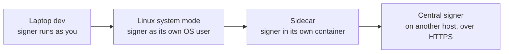

# Deployment and isolation

A run is worth what its log is worth, and the log is worth what it would take to rewrite it. That depends on who can
reach the signer's keys and store. Tracekit lets you place the signer from "on the same laptop, as you" up to "on a
separate host", measures where it ended up, and writes that into every run. The agent's code doesn't change between
modes: `TRACEKIT_SIGNER` points it at the signer.

## Isolation is measured, not claimed

The signer works out how isolated each caller is from the connection itself. There is no request field where an agent
could claim a level.

| Connection | How the caller is identified | Recorded isolation |
|---|---|---|
| Unix socket, same OS user as the signer | Peer credentials from the kernel | `same-user` |
| Unix socket, a different OS user | Peer credentials from the kernel | `separate-user` |
| HTTPS | A Kubernetes service account, mTLS (SPIFFE), OIDC or a named token | `remote` |

On Linux, credentials are checked on every message, not only at connect, so a socket handed to another process can't
speak for its original owner. Isolation is written into `run.registered` and shown in every verify report.

## The modes

| Mode | Who can reach the keys and log | Recorded isolation | Platforms |
|---|---|---|---|
| Laptop dev (`tracekit up`, or started by `tracekit.instrument()`) | The agent's own user | `same-user` | macOS, Linux, Windows |
| Laptop system mode (`tracekit init --v2 --user AGENT` as root) | Root and the signer's OS user | `separate-user` | Linux; macOS experimental |
| Container or Kubernetes sidecar | The signer's uid and the node's administrator | `separate-user` | Linux |
| Docker Compose stack | The Docker host's administrators | `separate-user` (the agent shares the signer's socket) | Linux containers |
| Central signer over HTTPS | The signer host's administrators | `remote` | Linux containers |

### Dev mode

The signer runs as you, which is also who the agent runs as. An agent that runs commands as you can read the signer's
key, stop it and re-sign the log, so dev mode protects nothing against the agent itself. It is for trying Tracekit and
for catching honest mistakes. Dev runs say `isolation: same-user`, self-approvals are allowed and recorded, and assurance
stays `dev`. Each `HOME` gets its own dev signer and store, even where two share a runtime directory.

### Linux system mode

`tracekit init --v2 --user AGENT`, run as root ([laptop system mode](../deploy.md#laptop-system-mode)), installs the signer under its own OS user, in a root-owned environment with a
hardened service unit (no capabilities, a read-only system, a system-call filter), and writes a root-owned client config
so an agent can't point its hooks at a decoy signer. The agent's user must not be root or in admin, sudo or docker
groups. Optional extras:

- **Harness binding**: only processes descended from a registered, root-owned program (for example the Claude Code
  binary) may write to a run, checked through `/proc`.
- **Egress**: a firewall rule that forces the agent's user through the [egress observer](custody.md#the-egress-observer).

### Sidecar

The signer runs in its own container in the agent's pod, sharing only its socket directory, read-only. Both containers
run as non-root with a read-only filesystem and no capabilities, and the agent is identified by its uid. Cloud
credentials don't belong in the pod (workload identity hands them to every container); use a central signer for a KMS
log key. Helm chart and manifests: [Kubernetes](../deploy-kubernetes.md). For agents in a Kubernetes agent-sandbox
`Sandbox`, put the signer outside it, in its own namespace, so deleting the Sandbox doesn't take the record along
([agent-sandbox](../integrations/agent-sandbox.md)).

### Central signer

One signer per log on its own host, reached over HTTPS, with Postgres storage and optionally a KMS log key. Callers
authenticate with service-account tokens, mTLS, OIDC or named tokens; HTTPS is required off loopback. A Docker Compose
stack bundles a signer, a witness, the viewer and Postgres on one host ([compose](../deploy-compose.md)); its agent
reaches the signer through a shared Unix socket, as its own uid. Its in-stack witness is the operator's, so it reaches
`local` assurance unless you add an independent one.

## Isolation and assurance are different

Isolation answers "could the agent rewrite the log?". Assurance answers "would anyone outside notice if the operator
did?" ([verification](verification.md#assurance-levels)). A well-isolated signer with no independent witness still
verifies at `dev`: the agent can't touch the log, but nothing outside vouches against the operator.

## Checking a setup

`tracekit doctor` checks that a setup does what it claims. It detects the mode, then among other checks: drops to the
agent's user and tries to reach the keys and store, checks key file permissions and that keys are distinct, checks a
Postgres role can't update or delete records, warns on fast-but-weaker durability in production, checks witnesses are
configured and fresh, and checks clock skew. For Kubernetes it checks security contexts, shared volumes and workload
identity. For coding agents it checks their sandbox settings and whether their reasoning will be readable. Its output is
advice, not evidence: nothing it prints is signed. Every check: [doctor](../doctor.md).

## Reference

[Deployment guide](../deploy.md) · [container](../deploy-container.md) · [Kubernetes](../deploy-kubernetes.md) ·
[compose](../deploy-compose.md) · [identity](../identity.md) · [platforms](../portability.md) ·
[threat model (laptop)](../threat-model-laptop.md) · [threat model (server)](../threat-model-server.md)

---

Previous: [Provenance and `tracekit why`](provenance-and-why.md) · [All concepts](README.md) · Next:
[Storage, durability and performance](storage-and-performance.md)
