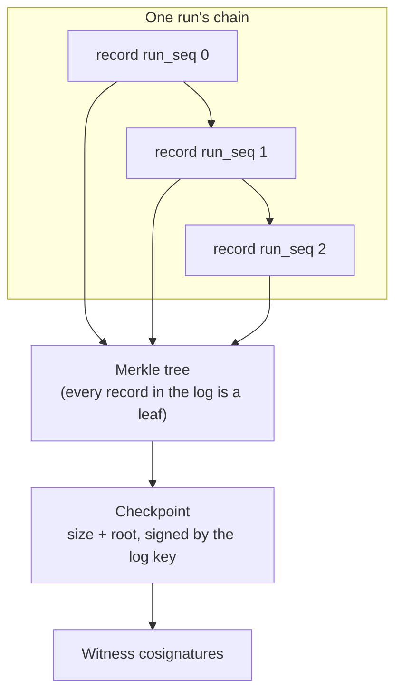

# The evidence format

Tracekit's evidence is a log of signed records. Each record is linked to the one before it, every record is a leaf in
a Merkle tree, and signed checkpoints of that tree are cosigned by witnesses. Content the agent handled is kept out of
the records as keyed commitments. One run, with the proofs needed to check it, exports as a `.tkb` bundle. This page
explains each layer and why it's there; the byte-level specification is [format v2](../format-v2.md).



## Records

A record is one line of JSON with exactly six keys:

```json
{"v": 2, "event": {...}, "hash": "sha256:...", "alg": "ed25519", "kid": "sha256:...", "sig": "..."}
```

- `event` is the content: a decision, a result, an approval, a gap. Its fields follow a closed JSON Schema
  ([`tracekit.event.v2.json`](../../tracekit/schema/tracekit.event.v2.json)).
- `hash` is SHA-256 over the event in canonical JSON.
- `kid` identifies the signing key: the SHA-256 of its public key, which also binds the algorithm.
- `sig` is the Ed25519 signature described below.

Every event says where it came from (`source`: the hook, the SDK, a gateway, the signer itself, an import) and, for tool
calls captured outside the agent's process, its tier. Fields only the signer may set (sequence numbers, isolation,
gaps, tamper records) can't be supplied by a client.

## What is signed

The signature doesn't cover the event body directly. It covers a small canonical object that ties the event's hash to
its place in both chains:

```text
JCS({alg, kid, log_id, seq, prev_hash, tenant, run_id, run_seq, run_prev_hash, hash, "t":"tracekit.record.v2"})
```

- The body is bound through `hash`, and the record's position through the two chains, so a genuine record can't be
  moved to another place in the log or into another run.
- `t` is a domain-separation tag. Checkpoints, approvals, key certificates, key retirements and exports each sign under
  their own tag, so a signature made for one purpose can't be replayed as another.
- Verification is strict Ed25519: a canonical `S`, no small-order or non-canonical public keys. The `alg` must be in
  the verifier's allowed list and must be the key's own algorithm, which rules out algorithm-confusion attacks.

## Canonical JSON

A signature only checks out if signer and verifier serialise the same bytes. Tracekit uses JCS (RFC 8785), and parses
strictly first: it refuses duplicate keys, NaN and Infinity, integers outside ±(2^53−1), lone surrogates, invalid UTF-8
and nesting deeper than 128 levels. Arguments that fail are denied (`TK-ARGS-INVALID`) rather than recorded ambiguously.
Test vectors pin the encoding for other implementations: [tests/vectors](../../tests/vectors).

## Two chains

| Chain | Fields | What it protects |
|---|---|---|
| The log chain | `seq`, `prev_hash` | The order of every record in the log |
| The run chain | `run_seq`, `run_prev_hash` | The order and completeness of one run's records |

Only the signer's single writer assigns these, so the agent can never leave a hole or reorder records. Because each
event contains `run_prev_hash`, the last record of a run commits, through the chain, to every record before it.

## The Merkle tree

Every record's hash is a leaf of an RFC 6962 Merkle tree (leaf = `SHA-256(0x00 ‖ hash)`, node =
`SHA-256(0x01 ‖ left ‖ right)`; the prefixes stop a node being passed off as a leaf). The tree gives two kinds of
proof:

- **Inclusion proofs** show a record is in the tree a checkpoint signed. A bundle needs them only for each run's first
  and last record (plus key records and records the registry points to): the run chain covers everything between.
- **Consistency proofs** show a newer tree extends an older one. Witnesses use them to refuse forks and rollbacks.

The tree is stored as C2SP tlog-tiles, which is storage, not evidence.

## Checkpoints

A checkpoint is a C2SP signed note: the log's origin, tree size and root hash, signed by the log key.

```text
tracekit.local/<log_id>
<tree size>
<base64 root hash>

— <key name> <base64 key id and signature>
```

A witness cosignature is a further line carrying the witness's own timestamp. Because the format is a standard,
existing witness software (omniwitness, litewitness) can cosign Tracekit logs without knowing anything about agents.

## Commitments

Records are meant to be shared, so they don't contain the agent's arguments or results. They contain keyed
commitments:

```text
args digest = sha256(JCS({"tool", "args"}))
salt        = HMAC-SHA256(args_salt.key, a label unique to the record)
commitment  = "hmac-sha256:" + HMAC(salt, args digest)
```

A plain hash of a short value (a PIN, "yes", an account number) could be guessed by trying values; a keyed commitment
can't. Each record has its own salt, so `tracekit signer reveal --record N` opens exactly one record for an auditor and
nothing else. Verification never needs a salt, and the policy still decides on the real arguments: only the records
hold commitments. What still shows (timing, sizes, counts): [privacy](../privacy.md).

## The content vault

To keep the content itself for investigations, turn on the vault (`content: {retain: true}` in the signer config).
Content is encrypted with AES-256-GCM under a key per run, bound to its record so a blob can't be moved to another one.
Every read needs a grant agents never get and writes a signed `content.accessed`. Erasing a run (`content_erase`, or
the retention period) deletes its key and writes `content.erased`. Bundles never contain vault content.

## Keys

| Key | Signs | Notes |
|---|---|---|
| Log key | Checkpoints | Stable for the life of the log. A file, or AWS KMS |
| Record keys | Records | Announced in the log (`signer.epoch`) and ended with `key.retire{kid, last_seq}`. Validity is positional: a record signed after the key's last sequence fails |
| Issuer certificates (experimental) | Short-lived record keys | Each certificate is a leaf in the issuer's own log, cosigned by a witness before the signer gets it, so a secretly issued key can't verify ([issuer](../issuer.md)) |
| SLH-DSA (experimental) | A second checkpoint line | A post-quantum signature (FIPS 205) beside Ed25519. Records stay Ed25519 |

The signer also holds HMAC and encryption keys for run tokens, commitments, approval copies and the vault. The agent
holds none of them.

## Registries and run-sets

A bundle for one run can't show runs that were left out. Each tenant therefore has a **registry log** with a fixed-size
leaf for every run registered, run finalised, key retired and tenant-wide gap. A **run-set** is a range of registry
leaves between two registry checkpoints with a consistency proof: it proves which runs exist in that window, so a
deleted run, a second `run.final` or a hidden key retirement shows.

## Bundles

A `.tkb` file is a zip in one strict layout: the run's records, the key records, inclusion proofs, checkpoints,
optional Rekor and timestamp anchors, the policy snapshots its records cite, and registry files for a run-set. A
manifest lists every file's SHA-256 but is only an index. Anything outside the layout (comments, zip64, extra fields,
symlinks, sizes over the limits) makes the bundle `UNUSABLE BUNDLE`.

Two things are deliberately missing: **verification code** (the party being checked must not supply the checker) and
the **trust configuration** (the person verifying brings their own).

## Compatibility

Evidence has to stay checkable for years. Formats only grow, each format's verifier is frozen, and the test bundles
for old formats are never regenerated. Schemas are closed, so an older verifier would otherwise reject a record type
it has never seen; instead each bundle names the minimum verifier version it needs, and an older verifier reports
`UNVERIFIABLE (needs tracekit >= x)`, never `FAILED`.

## Reference

[Format v2](../format-v2.md) · [privacy](../privacy.md) · [issuer](../issuer.md) · records and signatures:
[`tracekit/format/`](../../tracekit/format) · bundle export: [`tracekit/bundle_v2.py`](../../tracekit/bundle_v2.py)

---

Previous: [The life of a tool call](tool-call-lifecycle.md) · [All concepts](README.md) · Next:
[Verification and assurance](verification.md)
