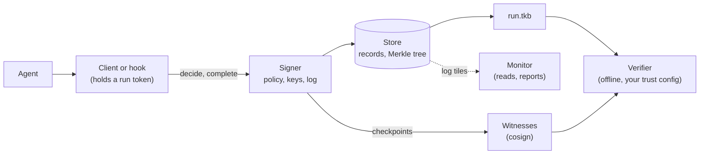

# Overview

An AI agent that runs commands, changes databases or sends messages leaves a log, but the agent's own process writes
that log. When a prompt injection or a bug makes the agent do damage, the same process can edit the log or skip it.
Teams also need to show what happened to people who weren't there and don't have to trust them: a security team, an
auditor, a customer.

Tracekit is a flight recorder for agents built for that situation. A separate service, the **signer**, sits between
the agent and its tools. Before each tool call runs, the signer checks it against your policy and allows it, denies
it, or holds it for a person. It signs every call, decision and result into a hash chain inside a Merkle log, and
independent **witnesses** cosign the log's checkpoints. Each run exports as one `.tkb` bundle that anyone can verify
offline, against keys they pinned themselves.

## The moving parts

| Part | What it does | Who runs it |
|---|---|---|
| Agent | Your program: a model and the tools it calls | You |
| Client | The SDK, a framework adapter or a coding-agent hook. Asks the signer to decide each call and reports results. Holds a run token, never a key | Inside the agent's process |
| Signer | Decides each call with its own policy, signs every record, assigns sequence numbers, keeps the log, signs checkpoints | You, out of the agent's reach |
| Store | Files or Postgres holding records and the Merkle tree | You |
| Witness | Cosigns checkpoints after checking the log only grew. Never sees records | Someone you don't control |
| Monitor | Reads the log, checks it makes sense (one start and one end per run, no surprise keys) and signs a report | Someone you don't control |
| Verifier | `tracekit verify` (Python) or the independent TypeScript verifier. Checks a bundle offline | Whoever needs to trust the run |
| Viewer | `tracekit view`: runs, decisions, approvals, gaps, replay, why | You (its verdicts are operator-side) |

The idea underneath is simple: **who can rewrite the log decides what a run is worth.** The agent never holds a
signing key and never numbers records. The further the signer is from the agent (another OS user, a sidecar, another
host), and the more independent parties vouch for the log, the more a run proves.

## What a verified run proves

A verified run proves what Tracekit's capture path recorded, and that the record has not changed since it was signed
and checkpointed. In detail: the records in the bundle are the ones the signer signed, none were edited, removed,
reordered or added afterwards, and they are covered by a checkpoint signed by the log key you pinned. The report's
assurance line says who else vouches for that checkpoint.

It does not prove:

- **Intent.** A record says a call was made, not why. ([Provenance and `tracekit why`](provenance-and-why.md) helps
  with why.)
- **That everything was captured.** An action that crosses no capture layer leaves no record. Completeness is
  reported, never claimed ([capture and completeness](capture-and-completeness.md)).
- **That a reported result is true.** Capture inside the agent's process proves what the agent *reported*; capture
  outside it proves what crossed that boundary ([custody](custody.md)).
- **That nothing was deleted.** It proves deletion shows. Tracekit is tamper-evident, not tamper-proof.

Integrity (the chain, signatures and witnesses) and completeness (the capture paths) are kept separate throughout:
the first is proven, the second is measured and reported.

## Two generations

Tracekit 1.2 contains two signers:

- **v1**, the original laptop path: `tracekitd`, a JSONL ledger, Claude Code and other coding-agent hooks. It keeps
  working, and its bundles keep verifying with a frozen verifier.
- **v2**, the signer service these pages describe: signer-side policy, per-run chains in a Merkle log, C2SP witnesses,
  argument-bound approvals, gateways and executors, reconciliation, Postgres and HTTPS. New work is on v2.

`tracekit verify` picks the right verifier from the bundle's format. Moving from v1 to v2:
[migration](../migration.md).

## Stable and experimental

The stable core is tested end to end on every pull request and hardened first: the v2 signer in dev mode and Linux
system mode with file storage, `tracekit.instrument()` and the OpenAI Agents, LangChain / LangGraph, Claude Agent SDK
and MCP integrations, the Claude Code hooks, policy v2 and its packs, approvals from the command line, bundle export,
both verifiers, `tracekit view` and `tracekit doctor`. Everything else (witnesses, the monitor, gateways, containment,
agent approvers, `tracekit why` and more) is experimental and says so when it starts. The full list:
[what's stable](../support.md).

## How it relates to other tools

| Kind of tool | What it does | How Tracekit relates |
|---|---|---|
| Observability (Langfuse, LangSmith, Phoenix, OpenTelemetry) | Traces for debugging and evaluation | Their traces are kept by whoever runs the agent and aren't signed or witnessed. Tracekit imports OpenTelemetry and exports spans that carry record hashes: debug with them, prove with Tracekit |
| Guardrails and classifiers | Judge content inside the agent's process | Tracekit's gate is simpler (deterministic rules) but runs outside the agent, and every decision is signed and recomputable |
| Sandboxes | Prevent effects, see system calls | Tracekit doesn't do either; it records what happened in a form a third party can check. Use both |
| Cloud audit logs | Record API calls to a provider | Kept by the operator, and unaware of agent tool calls, approvals or policy |

---

[All concepts](README.md) · Next: [The life of a tool call](tool-call-lifecycle.md)
