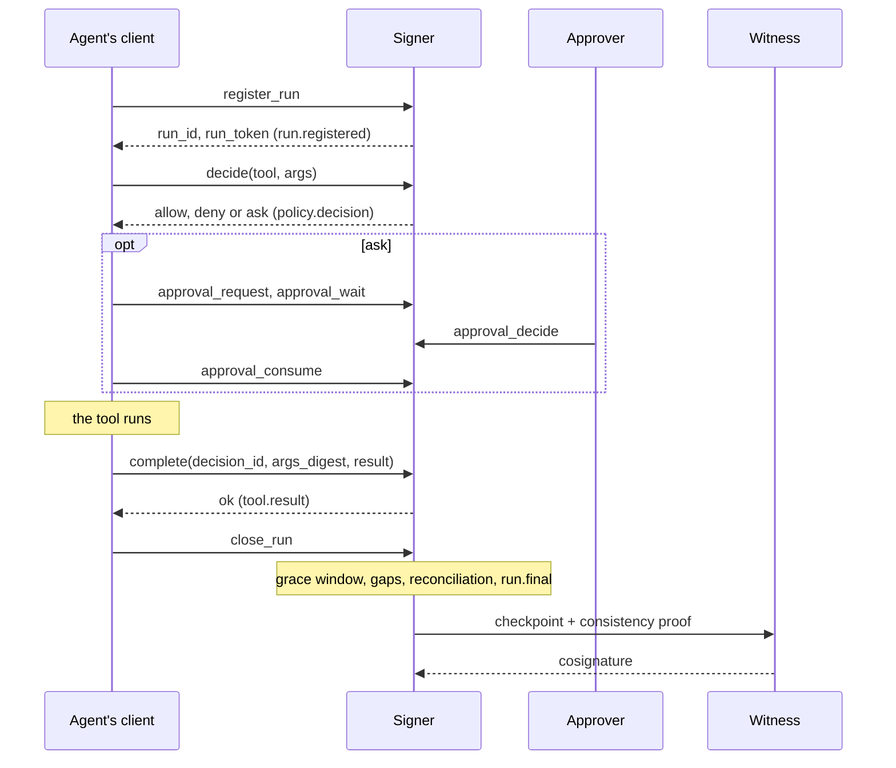

# The life of a tool call

Every tool call an agent makes goes through the same steps: the client asks the signer whether the call may run, the
call runs (or doesn't), the client reports the result, and the signer records each step as a signed record. Records
belong to a run, and a run ends with a signed `run.final`. This page follows one call and one run from start to end.

## Sequence



## Starting a run

`register_run` returns a `run_id` and a **run token**. The signer writes `run.registered`, which records the agent,
the isolation the signer measured for the caller, the fail modes that apply, the caller's identity, and (when
configured) the harness process and the parent run.

The run token is a capability for that one run: `b64url(payload).b64url(HMAC-SHA256(run_token.key, ...))`, with the
tenant, run id and caller identity in the payload. It is bound to the identity that registered the run, so in system
mode only that OS user can use it. It is an HMAC under its own key, not the evidence signing key, so it can never stand
in for a signature. A run that has gone final refuses every write. Sub-agents register with their parent's token,
which links the runs.

## Deciding a call

The client sends `decide` with the tool name, the arguments, how they were obtained (`args_source`: raw, parsed or
coerced), an optional class hint, the client's call id and attempt number, and a client counter.

The signer then:

1. parses the arguments strictly (canonical JSON rules) and denies arguments that aren't valid (`TK-ARGS-INVALID`);
2. classifies the tool from its own policy; a hint can only make the decision stricter, and a disagreement is a signed
   `class_mismatch` gap;
3. evaluates the policy over the raw arguments ([policy](policy.md));
4. signs a `policy.decision` with a fresh `decision_id`, every matching rule id, the policy hash, the regex engine and a
   commitment to the arguments ([commitments](evidence-format.md#commitments)).

It answers `allow`, `deny` or `ask`. A `flag` rule lets the call run and marks it only in the signed record. A deny or
ask is remembered per call id and attempt, so a retry with the same attempt gets the same answer.

## Holding a call

For `ask`, the client asks for an approval, waits, and consumes it just before running the call. The approval is bound
to the exact arguments and used once. The whole flow, and who may answer: [approvals](approvals.md).

## Completing a call

After the tool runs, the client sends `complete` with the `decision_id`, the digest of the arguments it ran, and the
result or error. The signer checks the digest opens the decision's commitment (otherwise `args_mismatch`), redacts the
result, commits to it, and writes `tool.result`. If the call ran against a deny, or after an ask with no consumed
approval, the signer also writes `capture.gap{executed_against_policy}`.

Other events a client can record: `observe` (content the agent read, such as a page or a ticket), `state_write`
(digests of saved agent state, to detect tampering with it) and `model_event` (model calls, when no gateway records
them).

## Closing a run

`close_run`, or an idle timeout of one hour (paused while an approval is pending), writes `run.closing`. A short grace
window follows (5 seconds, longer when a gateway or an egress observer covers the run) in which only late records are
accepted. Then the signer writes:

1. completeness gaps, such as decisions that never got a result;
2. reconciliation findings, comparing what different capture layers saw
   ([capture and completeness](capture-and-completeness.md));
3. `run.final`, with the run's last record and hash, the capture coverage and the coverage matrix.

## Checkpoints and anchors

The signer signs a checkpoint of the whole log after each `run.final`, every 10 seconds while the log grows, and on
request (at most once a second). It sends each checkpoint to its witnesses with a consistency proof, and at most once an
hour anchors one in Rekor. A run's records are covered once a checkpoint includes them.
([Witnesses and monitoring](witnesses-and-monitoring.md).)

## Exporting and verifying

```sh
tracekit export --v2 --run RUN_ID -o run.tkb      # one run as one bundle
tracekit verify run.tkb --trust trust.json         # offline, against the keys and witnesses you pinned
tracekit last                                      # the dev signer's latest run: export, pin and verify in one step
```

What the verifier checks: [verification and assurance](verification.md).

## Who assigns what

| Value | Set by | Why it matters |
|---|---|---|
| `seq`, `prev_hash` (log chain) | Signer | Orders every record in the log |
| `run_seq`, `run_prev_hash` (run chain) | Signer | Orders a run's records; a gap or reorder shows |
| `decision_id`, `approval_id`, commitments, timestamps | Signer | Bind results and approvals to decisions |
| Isolation, fail modes, gaps, tamper records | Signer only | No request field can carry them, so an agent can't claim them |
| `tool_call_id`, `attempt`, `client_seq`, `request_id` | Client | Correlate calls and retries; a skipped `client_seq` becomes a signed gap |

## The RPC surface

Clients and services talk to the signer over a Unix socket, loopback TCP (Windows dev mode) or HTTPS, as
newline-delimited JSON. The protocol is versioned (16; the 1.2 signer also accepts 15), and a client newer than its
signer is refused.

| Group | Calls |
|---|---|
| Runs and events | `register_run`, `decide`, `complete`, `observe`, `state_write`, `model_event`, `close_run`, `status` |
| Approvals | `approval_request`, `approval_wait`, `approval_decide`, `approval_consume`, `approval_list`, `approval_abandon`, `approval_review`, `approval_revoke`, `approval_agents` |
| Services | `delegate_run`, `tailer_heartbeat`, `observe_effect`, `decision_import` |
| Content and why | `content_get`, `content_erase`, `why_finding` |
| Operators | `incident_list`, `incident_resolve`, `run_hold`, `run_quarantine`, `run_resume`, `suspend` |

State-changing calls carry a `request_id`. A retry with the same id and payload returns the original answer; the same id
with a different payload is a `conflict`.

## Reference

[Architecture](../architecture.md) · [quickstart](../quickstart-v2.md) · the signer:
[`tracekit/signer/service.py`](../../tracekit/signer/service.py), the writer:
[`tracekit/signer/pipeline.py`](../../tracekit/signer/pipeline.py), the RPC contract:
[`tracekit/signer/rpc_schema.py`](../../tracekit/signer/rpc_schema.py)

---

Previous: [Overview](overview.md) · [All concepts](README.md) · Next: [The evidence format](evidence-format.md)
