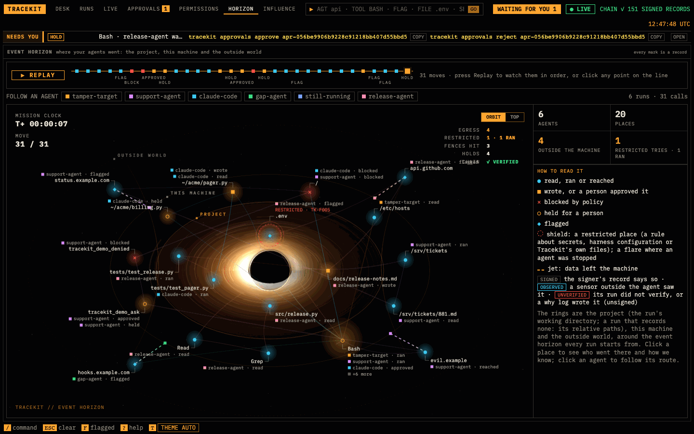
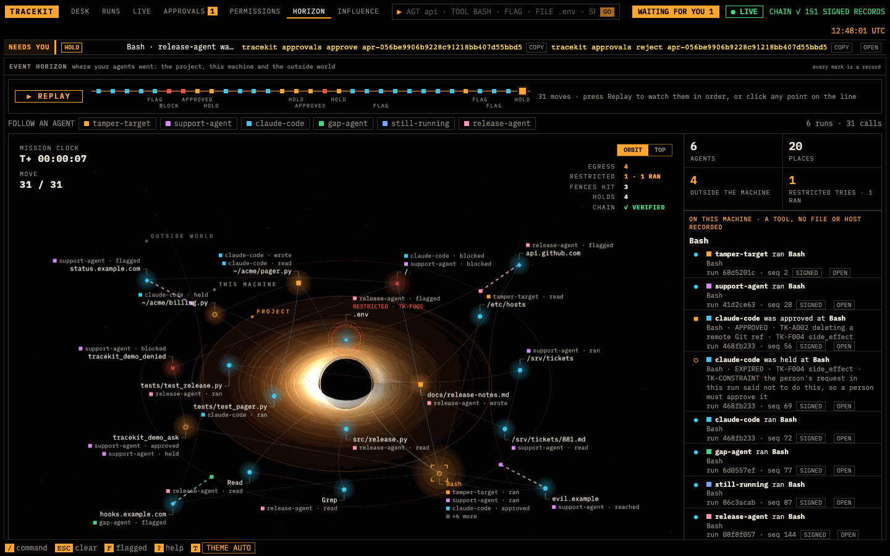
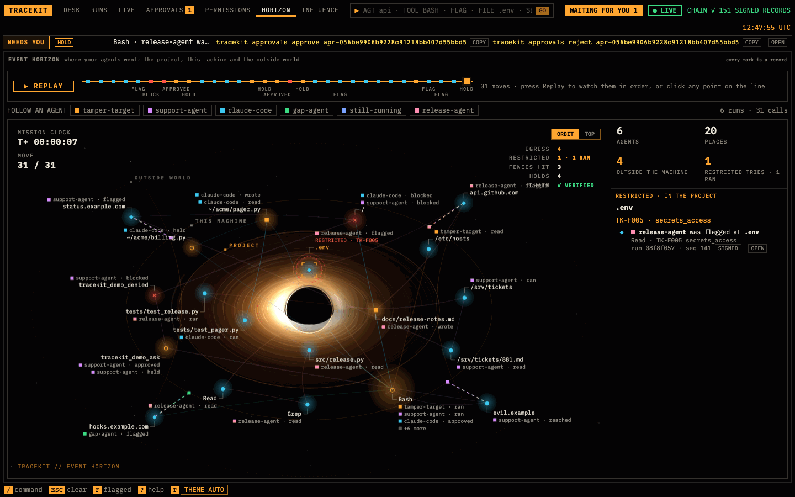

# Event Horizon

Event Horizon is the map of where your agents went (the project, this machine and the outside world) and how we know.



## Open it

It is a page of [`tracekit view`](viewer.md), for any source the viewer shows: a signer's runs, a v1 ledger or bundle,
or why logs.

```bash
tracekit view --dev
```

Open the URL it prints, then **HORIZON** in the header. Its link is the viewer's address with `#page=horizon`
(`#page=map` opens it too).

## What the map shows

Every run's calls sit around a black hole, the event horizon every run starts from, on three rings:

| Ring | Its places |
|---|---|
| **PROJECT** | the files inside the run's working directory, or the relative paths of a run that records none (a v2 run records none), by their top folder |
| **THIS MACHINE** | the other paths (a home directory reads as `~`) |
| **OUTSIDE WORLD** | hosts: of a URL, or of an email address |

A call's place is the first host or path among its arguments (the signer's copy), its subject first. A call that names
neither is placed by its tool: on this machine, or outside for a network tool.

Each mark is a call, or a file or network effect a kernel sensor saw: `●` read, ran or reached; `■` wrote, or a person
approved it; `✕` blocked by policy; `◯` held for a person; `◆` flagged. A **shield** marks a restricted place: a `TK-F`
or `TK-D` rule about secrets, credentials, harness configuration or Tracekit's own files matched a call there. A flare
on the shield means an agent was stopped there (blocked or held). A **jet**, a dashed line out to the outside world,
marks each call to a host there.

Over the map, **MISSION CLOCK** is the time since the first move and **MOVE** the move shown; **EGRESS** counts the hosts
outside reached, **RESTRICTED** the moves at restricted places and how many ran, **FENCES HIT** the blocked calls,
**HOLDS** the held ones, and **CHAIN** reads `✓ VERIFIED` when no move drawn is unverified, else how many are. Beside
it: the agents, the places, the places outside the machine and the restricted tries, then how to read the marks.

## How we know

Each move carries one grade:

| Grade | Means |
|---|---|
| **SIGNED** | the signer's record says so: a call of a run the viewer verified |
| **OBSERVED** | a sensor outside the agent saw it: an effect a kernel sensor recorded ([Tetragon](integrations/tetragon.md#checking-effects-against-calls)), in a run the viewer verified |
| **UNVERIFIED** | its run did not verify, or a why log wrote it (the agent's own record, which nothing signs) |

The grades are the viewer's check, operator-side: the run's bundle, checked with `tracekit verify`, is the evidence.

## Replay, follow, orbit

**REPLAY** plays the moves in order, one a second, and **PAUSE** stops. The line beside it has a point per move, with
its BLOCK, HOLD, APPROVED and FLAG milestones named; click any point to show the map as of that move.
**FOLLOW AN AGENT**: click an agent to draw only its route, numbered, and list it beside the map; click it again for
every agent. **ORBIT** (the default) tilts the map; **TOP** shows it from above. With reduced motion (your system's
setting) the map draws still frames, one for each change.

## Click a place

Click a place to see who went there and how we know: each move there with its agent, what it did, the tool and
the rules that matched, its run and seq, its grade, and **OPEN**, which opens the record on its run's page. The heading
names the ring, and says **RESTRICTED** with the rule that made it so, or **A TOOL, NO FILE OR HOST RECORDED** for a
place named after a tool. Click the place again for the key.





## Calls placed by their tool

A v2 record keeps a call's arguments only as a salted commitment. The viewer reads them with the dev signer (from its
[content vault](privacy.md#the-content-vault)); a call whose arguments it has only as a commitment names no file or
host, so it is placed by its tool, on this machine or outside for a network tool. The page says how many calls are
placed that way.

## Limits

- It draws the newest 500 calls and sensor effects of all runs together, by the signer's time, and says how many it
  leaves out; a run's CALLS has every call ([limits](limits.md#investigation-tracekit-why)).
- A v2 run records no working directory, so its project ring holds only relative paths; an absolute path is on this
  machine ([limits](limits.md#investigation-tracekit-why)).
- A call whose arguments the viewer has only as a commitment is placed by its tool, not at a file or host
  ([limits](limits.md#investigation-tracekit-why)).
- A word with a slash in a call's arguments is read as a path, so a git ref such as `origin/main` is drawn as a project
  place.
- It shows the network effects a kernel sensor saw, not the egress observer's records
  ([limits](limits.md#investigation-tracekit-why)).
- A why log time it can't read is drawn as the oldest ([limits](limits.md#investigation-tracekit-why)).
- Its grades are operator-side, not evidence ([limits](limits.md#viewer)).
