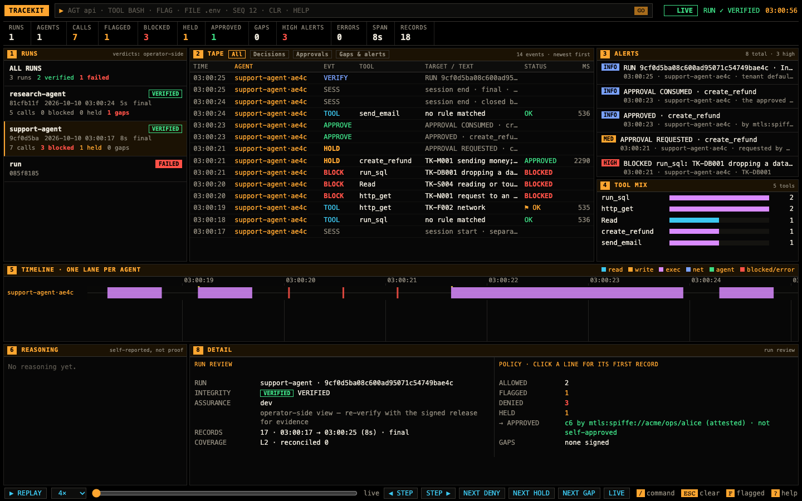

# Viewer 1.4

This page describes `tracekit view` as it was in Tracekit 1.4.x, unchanged. For 1.5 and later, see
[Viewer](viewer.md).

`tracekit view` is Tracekit's one viewer: one command, one page, one server, whatever the runs come from.

| Command | Shows |
|---|---|
| `tracekit view` (`--dev`, `--config signer.yaml`, `--data-dir DIR`) | the v2 signer's runs, each verified ([below](#laptop-viewer)) |
| `tracekit view --dev --why DIR` | those runs with the why investigation of their why logs ([below](#why)) |
| `tracekit view --why DIR` | why logs alone, each run's events on the tape |
| `tracekit view --ledger [HOME]`, `tracekit view --bundle FILE` | the v1 ledger (`tracekitd`), or a v1 bundle once it verifies; loopback only |
| `tracekit view --config signer.yaml` with `view.logs` | every log of a central deployment ([below](#central-viewer)) |

The nav at the top of each page links the pages this server has: **LIVE** (the run list, tape and detail; with why
logs, the header's DESK, RUNS, OVERVIEW, TIMELINE, WHY DID IT HAPPEN?, GRAPH, AGENTS and INFLUENCE buttons switch to the
investigation), **RUNS** (the central run
pages) and **APPROVALS** (with OIDC login and `view.signer`, for approvers). `tracekit observe` and `tracekit why serve`
still work as before and print one line pointing here. A single bundle's self-contained `replay.html` stays a file
you open without a server.

## Tour

Open it with one command, then open the URL it prints (it carries a one-time token):

```bash
tracekit view --dev                     # the dev signer's runs
tracekit view --why runs --allow-program tracekit.why.demo:SYSTEM   # after `tracekit why demo --out runs`
```

The screenshots below come from two runs of a coding agent (two calls denied by the policy), the `tracekit why demo`
runs, and the sample v1 bundle.

### Runs and the tape


Panel 1 lists each run with its verdict: `VERIFIED` means `tracekit verify`'s checks passed on the run's bundle against
the pinned log key (here the store's own key: `dev` assurance); `FAILED` means they did not, and the run shows only its
failure report (a run that verified at an earlier checkpoint and fails at a later one has the records it showed, and
its earlier report and findings, taken back); `ERROR` means the viewer could not check the run (its NOT CHECKED row
says why; it tries again five minutes later or when the run grows); `PENDING` means no checkpoint covers the run's
records yet. A viewer that stops checking runs altogether says `STOPPED`, not `LIVE`, with the reason, until it
restarts. A run still being written is shown up to the newest
checkpoint and grows with each one; a long run is checked again no sooner than four times its last check's time. A run
that stopped growing is checked again five minutes after its last check, one run at a time, so a later edit of its
records turns it `FAILED`. Past 50,000 rows (`TRACEKIT_OBSERVE_MAX_RECORDS`) the oldest leave the live view and the tape
says how many; each run's latest verdict stays in the run list, for up to 10,000 runs (a failed run's goes last).
Under each run: calls, **blocked** (red: the policy
denied them), held for a person, and signed gaps. Panel 2, the tape, has one row per signed record: `BLOCK` a denied
call (red), `TOOL` an allowed one (`⚑` flagged by a rule), `HOLD` a call held for a person, with its approvals folded
under it and its final state (`APPROVED · RAN`, `REJECTED`, `EXPIRED`, `WAITING`) in STATUS, `SESS` the run's start and
end. A row marked `ANALYSIS` is the viewer's own work, not a record: `VERIFY` (the verifier's report) and the `FINDING`s
of its analysis have no seq and no hash, and replay skips them; a row marked `WHY` comes from a why log. A findings
run's signed findings (`tracekit analyze --v2`) are `FINDING` rows of that run: each says who wrote it (the identity the
signer measured for the findings run) and the reviewer the analyzer names (its own claim); `tracekit verify` says
whether that author is independent of the analysed run or self-asserted. The tape renders the newest 600 rows; **SHOW
OLDER** at its end renders more. Times are your browser's local time; the clock names the zone. The header's `CHAIN ✓ N
SIGNED RECORDS` and `RECORDS` count the records shown from runs that verified. Click a run to scope the whole page to
it; **All runs** goes back. A red bar under the header says when the page lost its viewer: it reconnects on its own and
reloads the records.

### A run's review


With a run selected and no row, panel 8 is the run review. It opens with one sentence ("Verified. 8 calls: 5 ran, 1
blocked, 3 held (1 rejected, 1 approved, 1 expired). 2 findings, 1 high."), then Integrity, Assurance, how many calls
were allowed, flagged, denied and held, who approved, gaps in words (the gap's kind is the line's tooltip) and
coverage. Click a line to jump to its first record. Every verdict here is operator-side: for evidence, verify the
bundle yourself with keys you pinned; **EXPORT** and **VERIFY** give the exact `tracekit export --v2` and
`tracekit verify` commands, each with a **COPY** button. A run that fails leads with its failing check.

### A denied call


Click a tape row for its record: the decision (`DENY → BLOCKED`), the rules that matched with their reasons, the run's
verdict, the arguments the dev signer kept (when it kept them), the arguments commitment (v2 records keep arguments
only as a salted commitment) and, on the right, the record's seq, hash and previous hash in full. **COPY** copies a
hash, a run id or the `tracekit signer reveal` command. The findings that cite a record are listed on it, and a
finding's CITES opens the records it cites. The bottom bar replays the selected run: `SPACE` (or `PLAY` and `PAUSE` in
the command box) plays, `←` `→` step, `D` `H` `G` jump to the next deny, hold or gap (with none ahead, the box says
so), `L` returns to live.

### The command box


Type `/` (or click the box at the top), then a command and Enter: `AGT name`, `TOOL Bash`, `FILE .env`, `FLAG`
(flagged, blocked or failed only), `FIND text`, `SEQ n` (open record n), `CLR` (clear every filter), `HELP` (this
list). Each filter shows as a chip in the header; click its `✕` to drop it. `SEQ n` on a record with no row of its
own (a call's decision or result is on the call's row) opens the row before it and says so in the box.

### Why: the verdict and the path


With why logs, select a tool call (or click a `WHY` alert, panel 3) and open **WHY** in panel 8. The verdict sentence
says what replays found; **How it got here** is the recorded path from each untrusted input (red border) through the
agents' model calls and messages to the call. Click any step to open it. While WHY or NODE is open, panel 8 widens
so its tables and values wrap instead of being cut; DETAIL gives the room back.

### FIND THE CAUSE and RUN TEST


**Candidate causes** lists every input and channel upstream of the call. **RUN TEST** replays the run without one of
them (recorded tool results, new tool calls stubbed: nothing real is re-sent) and compares how often the call
happens: `PRIMARY CAUSE` (red) means it stops happening without it, `NO EFFECT SEEN` means no change larger than the
test can detect, `INCONCLUSIVE` means too few replays reproduced the call. **FIND THE CAUSE** runs a group test and
narrows it down. Both run only for a program passed with `--allow-program`; otherwise the panel prints the command.
The effect is the drop in how often the call happens, with its 95% interval.

### Runs, overview and timeline (Causeway's)

With why logs the header also has Causeway's views of a run; each takes panel 9, and the picker next to its title
chooses the run.


**RUNS** lists every run: alerts (`high` red, `review` amber), tests with how many were causal, and `intact` when the
log's hash chain checks. Click a run for its overview.


**OVERVIEW**: `LOG INTACT` (the why log's hash chain checks) and `REPLAYABLE` (the run names a program a replay can
import), what the agents did (a flagged call is red: click one for why it happened), what needs attention, each with
its confirmed causes and **INVESTIGATE →**, the run's numbers, and how to read the evidence: *reached* is recorded,
not proof; a *confirmed cause* changed how often the action happens in replays; *ruled out* changed nothing detectable.


**TIMELINE**: every event, filtered by agent, type (inputs, model calls, tool calls, messages), **flagged only** and
text. Click a row for its NODE.

### WHY DID IT HAPPEN?


The run's tool calls, high alerts first; pick one. **Argument value / where the value came from** says, for each
value, *only from untrusted content*, *from a trusted source* or *written by the model*, and which source. Then the
verdict, how it got here and the candidate causes, with each test's effect bar (dot = effect, whisker = its 95%
interval), with → without, and **text reuse** (how much of the content's wording the next model output reused).
**DETAILS** opens the call's NODE. The detail panel's WHY tab shows the same for the call selected on the tape.

### GRAPH: click a node


**GRAPH** (header buttons) draws the run's data flow as a left-to-right flowchart, as Causeway did: inputs (cyan),
model calls (magenta), tool calls (green), messages (amber), each arrow a recorded flow; a red border is untrusted
content, a thick red arrow a confirmed cause with its effect, a dashed one an inferred link, an amber dot a sensitive
tool call. **FIT** (the default) fits the flowchart to the panel's width and height, never above actual size;
**ACTUAL SIZE** scrolls; **CLEAR HIGHLIGHT** undoes a click. The legend names only the marks the graph has. A run of
more than 600 events is too large to draw: GRAPH says so, and TIMELINE, WHY DID IT HAPPEN? and a call's WHY tab show
it. The picker names each run by its agents and short id. Click a node: the graph
keeps what it came from and led to and fades the rest, and panel 8's **NODE** tab shows it in full: for a model call
its model, time, tokens, what it saw (each a link) and what it produced; for a tool call its arguments, result,
policy decision and a **WHY DID THIS HAPPEN?** button; for an input or a message its content and trust. **Came from**
and **Led to** link the neighbours; **Record** gives its time, hash, previous hash and the signed Tracekit record it
cites. Click the node again, or **CLEAR HIGHLIGHT**, to see the whole graph. The checkboxes add inferred links and ruled-out
tests.

### A signed run's graph


`tracekit view` on a signer store with no why logs (no `--why`, no `why/` in its data dir) still has GRAPH: each run that verifies is imported read-only
(`why import --store`'s import) into the viewer's own temp dir, imported again as it grows, and removed once its rows
leave the live view (past `TRACEKIT_OBSERVE_MAX_RECORDS`) or it fails. Its tool calls read
left to right in run order; each node carries its signed decision: **DENIED** (red), **HELD** or **FLAGGED** (amber),
**APPROVED**, or ALLOWED (muted), with the first rule id. Click a node: NODE shows the decision, every rule with its
reason, who approved, and the record it cites. A run's arguments are only a salted commitment, so WHY can list the
path but not replay it. With ACTUAL SIZE a flowchart wider than its panel scrolls sideways (`scroll →` in the
panel's title), and a clicked node is scrolled into view. A held call's node says how its approval ended
(**APPROVED**, **REJECTED**, **EXPIRED**). The why views follow the run selected in panel 1; a run that failed
verification has no graph, and GRAPH says why.

### AGENTS


Per agent: role, who spawned it, model and tool calls, messages, model time and tokens. **Channels used** says whether
a receiver's model call had each message in its context, and what a replay without the channel changed. The influence
matrix fills in as tests run; the critical path is the longest chain of the run.

### INFLUENCE


Across every why run, as a citation index: each source (left; a red ring is untrusted) to the tools it reached
(right), thicker for more runs, red with its effect where a replay confirmed it, dotted where one ruled it out. The
**sources** table gives each one's content, trust, runs, the decisions that cited it, its strongest tested effect and
the tools it is a confirmed cause of.

### A v1 bundle


`tracekit view --bundle FILE` verifies a v1 bundle first and shows it only if it verifies; `--ledger` shows the live
v1 ledger. A tampered bundle is refused before anything is served:

```text
$ tracekit view --bundle docs/sample/demo-run-tampered.tkb
tracekit view: bundle docs/sample/demo-run-tampered.tkb FAILED verification (exit 1); refusing to show it. Run `tracekit verify docs/sample/demo-run-tampered.tkb` for the details.
```

## Laptop viewer



`tracekit view [--dev | --config signer.yaml | --data-dir DIR]` reads one signer's store, read-only, and verifies each
run with the code `tracekit verify` runs. The page is the observer's terminal, for runs:

- **Runs** (panel 1): each run with its agent's registered name, the verifier's verdict (`VERIFIED`, `FAILED`, or
  `PENDING` until a checkpoint covers the run's last record; every verdict is operator-side, see below), start time,
  duration, and its calls, blocked, held and gaps. Clicking a run scopes the tape, timeline, tool mix and header to it;
  **All runs** restores the full view. A run that fails shows only its verifier report.
- **Tape** filters: All, Decisions, Approvals, Gaps & alerts. A held call's approvals are rows (`HOLD`, `APPROVE`,
  `REJECT`) folded under the call's row, in words: who asked, which rules, who answered (attested, or vouched for by a
  bridge), the reason, self-approval (an approval only) and break-glass. The signer's own records (`signer.epoch`, `refusal.summary`, key records) are
  the `signer`'s rows, not an agent's.
- **Detail**: a call's decision, its rules with their reasons, its arguments commitment and approval binding, and the
  verdict of its run. v2 records keep a call's arguments only as a salted commitment, so the viewer shows the rules'
  reasons instead (from the policy whose hash the decision records: a shipped pack or the config's `policy`; other
  policies show rule ids only); `tracekit signer reveal --record <seq>` gives an auditor the salt. With the dev signer
  (`tracekit view --dev`, 1.2.2), each call also shows what it ran: its redacted arguments from the dev signer's
  [content vault](privacy.md#the-content-vault), read once per run and refresh (a `content.accessed` record each).
- **Asked and said** (with the dev signer's content): a person's prompt is a `PROMPT` row, and what the model said a
  `THINK` or `SAYS` row and an entry of the Reasoning panel, labelled by its form (full, summary, withheld: sealed or
  absent). A call's detail shows what was said before it in the message that asked for it, marked "signed before this
  call" only when its record is older than the decision. It is the model's account: self-reported, not proof. Without
  content, a line shows as said, its text not kept here (the record holds only its commitment).
- **Run review** (detail, with a run selected and no row): Integrity and Assurance, allowed / flagged / denied / held
  and who approved, gaps by kind, coverage. Each line opens its first record. Once a dev run is final, its
  [findings](findings.md#v2-runs-what-was-asked-said-and-done-tracekit-analyze---v2) (`tracekit analyze --v2`) are
  `FINDING` alerts with links to the records they cite, and the review's FINDINGS, MONITORABILITY and NOT CHECKABLE
  lines, beside the integrity line, never in it.
- **Replay** (with a run selected): `SPACE` plays or pauses, `←` `→` step one record, `D` `H` `G` jump to the next deny,
  hold or gap, `L` or `ESC` returns to live. The header and tape show the run as of the playhead; the timeline marks
  it.

The timeline is scaled to the calls shown, not the clock. The page and server are the observer's, with its
checklist ([security-checklist.md](security-checklist.md)).

### Laptop viewer API

Every request needs the token: `$TRACEKIT_VIEW_TOKEN`, else a random one that `tracekit view` prints in its URL (with
`$TRACEKIT_VIEW_TOKEN` set the printed URL carries none: add `?token=…` yourself). Open `/?token=…` once: the page
exchanges it for an `HttpOnly` session cookie and reloads without it; the cookie holds nothing of the token and lasts
8 hours, and only while this viewer runs (open the URL again after that). A script sends `Authorization: Bearer <token>`
instead; `?token=` on an `/api/` path is refused (401), so the token never sits in an API URL. These requests are
`GET`s; with `--why` the replays and ingest are `POST`s ([below](#why)):

| Path | Answers |
|---|---|
| `/api/snapshot` | `{next, dropped, max, records, source?}`: the tape rows the page renders (each run's verifier report, then its records once it verifies), `next` the index to stream from, `dropped` how many rows left the live view and `max` how many it holds; `source` is `bundle` when the viewer shows a v1 bundle |
| `/api/verify` | `{records, ok, problems, head, stopped}`: how many records are shown from runs that verified, each run that failed or could not be checked with why (the header's chain badge), and `stopped`, why the viewer stopped checking runs if it did (the page then says STOPPED, not LIVE) |
| `/api/stream?from=N` | `text/event-stream`: one `data:` line per record from index `N` on, as they are recorded |
| `/api/why/workspace`, `/api/why/runs/<id>` | the why logs, with `--why` ([below](#why)) |

The run pages and their API (`/runs`, `/api/runs`, `/api/run`, `/api/bundle`) are the central viewer's, served only
with `view.logs` ([below](#pages-and-api)).

## Why

The viewer is also the UI of [`tracekit why`](why.md): with why logs it investigates them on the same page, so one run
is both signed evidence and a causal log.

```bash
tracekit view --dev --why runs --allow-program myapp.agents:SYSTEM   # the dev signer's runs with their why logs
tracekit view --why runs --allow-program myapp.agents:SYSTEM         # the same page on why logs alone, no signer store
```

`--why DIR` names the why logs (default: `why/` in the signer's data dir, where the signer-backed why runtime writes
them, when it exists). Without `--dev`, `--config` or `--data-dir` it shows the why logs alone. A tool call's why event cites the signed record it produced (`tracekit: {run_id, run_seq}`);
that citation joins the two.

- **Detail · where the arguments came from**: from the signed `provenance` of the call's decision (labelled
  `signed · observed`): each argument whose value only untrusted content brought into the run, its kind and the record
  that brought it (click to select it), never the value; `unavailable (signer restarted)` or `truncated` when the
  signer's index could not say. With a why log of the run, also the why analysis of each value: the task, a trusted
  input or result, an untrusted input or result, or written by the model.
- **Detail · WHY** (the detail's second view, for the selected call): the verdict sentence, **how it got here** (the
  observed path through agents, model calls and messages, from each of the 20 nearest untrusted inputs), **candidate causes** with their
  status (primary cause, contributing, confirmed, joint, inconclusive, no effect seen, ruled out, not tested), effect,
  95% interval and with → without rates, and **FIND THE CAUSE** / **RUN TEST**.
- **Views** (header buttons; the run list and tape stay): **RUNS**, **OVERVIEW**, **TIMELINE** and **WHY DID IT HAPPEN?**
  (as below), **GRAPH**, the run's data flow (observed edges; tested causes
  in red; inferred links and ruled-out tests hidden until ticked; click a node for what it came from and led to),
  **AGENTS** (the channels used, the influence matrix, the critical path), **INFLUENCE** (across runs: sources ×
  tools, with tested effects). **DESK** returns to the panels.
- **Alerts**: the why alerts (a sensitive call using a value only untrusted content supplied, a call downstream of
  untrusted input, evidence alerts) join the alert panel labelled `WHY`; signed records' alerts are labelled `SIGNED`.

FIND THE CAUSE and RUN TEST replay the run, so they run only for the programs passed with `--allow-program` (the run
names its program; replay imports it). Otherwise the panel shows the `tracekit why` command to run instead. New runs
and new alerts arrive over the page's event stream as they are recorded.

The why API is served by the viewer, on its session and checklist: `GET /api/why/workspace`, `GET /api/why/runs/<id>`,
`POST /api/why/runs/<id>/tests` and `/attribute` (the token, a same-origin JSON body) and `POST /v1/ingest` (a
Bearer token only: an `--ingest-token`, which reads nothing, else the token; [why.md](why.md#server-and-api)). Why logs belong to no tenant, so only the printed token
sees them, never an OIDC session.

## Central viewer

`tracekit view` with a `view.logs` section reads every log of a central deployment
([deploy-kubernetes.md](deploy-kubernetes.md)) and serves its runs to auditors, approvers and operators, read-only.

```yaml
data_dir: /tmp                        # the viewer's own; never a signer's
view:
  logs: [log-0.dsn, log-1.dsn]        # one DSN file per log (its schema), for a role holding READ_GRANTS only
  oidc: {issuer: corp, client_id: tracekit-viewer, redirect_uri: https://view.corp.example/callback,
         roles: {auditor: ["group:corp/auditors"], approver: ["group:corp/approvers"],
                 operator-admin: ["group:corp/sre"]}}
```

```bash
tracekit view --config viewer.yaml --host 0.0.0.0 --tls-cert tls.crt --tls-key tls.key
```

Each DSN's role holds `tracekit.storage.postgres.READ_GRANTS` (SELECT only), so the viewer can't write a log even by
mistake. Each log's verdicts pin the log vkey that log's store holds (or `--log-vkey`, for every log).

### Who sees what

| Session | Runs | Approvals |
|---|---|---|
| auditor (OIDC, the issuer's tenant claim) | its tenant's, read-only | none |
| approver (OIDC, the tenant claim) | its tenant's, read-only | its tenant's, with `view.signer` ([approvals.md](approvals.md#web-approvals-and-passkeys)) |
| operator-admin (OIDC) | every tenant's, read-only | none |
| the printed token | every tenant's, read-only | none |

The tenant is enforced in every query the viewer makes (a `tenant = …` condition taken from an auditor's or approver's
session, never from the request), not only on the page: a session of tenant A gets no run of tenant B from a list, a
search, a run's page or a bundle download, even with B's run id. Its only write path is the approval pages.

### Pages and API

`/runs` lists the runs, log by log, newest first, and searches them. Every request is a `GET`:

| Path | Answers |
|---|---|
| `/api/runs?run&agent&tenant&since&until&verdict&gaps&denies&approvals&limit&after` | `{runs, next}`: at most `limit` (50) runs, each with its log, tenant, agent, first and last event time, record count, gaps, denies, approvals and verdict; `next` is the `after` of the next page. `since`/`until` are RFC 3339 UTC times; `verdict` is `verified`, `failed` or `pending`; `gaps=1`, `denies=1` and `approvals=1` keep runs that have one; `tenant` narrows an operator-admin's list. One search query per log per page, plus a reader of each log with matching runs (it reads that log's index). |
| `/api/run?log&tenant&run&from` | the run's verdict with verify.v2's full report and, only when it verified, 500 of its records from the `from`th, with `next` |
| `/api/bundle?log&tenant&run` | the run's `.tkb` bundle |

A run's verdict is what `tracekit verify` gives the bundle the viewer exports from the store; a run whose last record no
checkpoint covers yet is `pending`, and a run that fails shows its failure report and none of its records. Every verdict
carries the label **"operator-side view — re-verify with the signed release for evidence"**: the viewer runs on the
operator's side, so its verdict is not evidence. An auditor downloads the bundle and checks it with `tracekit verify`
from the signed release, against keys and witnesses they pinned themselves ([auditor-guide.md](auditor-guide.md)).

The page and API pass the browser surface's checklist ([security-checklist.md](security-checklist.md)): strict CSP
with a fresh nonce, every value shown as text, `HttpOnly; SameSite=Strict` session cookies, and HTTPS off loopback.
