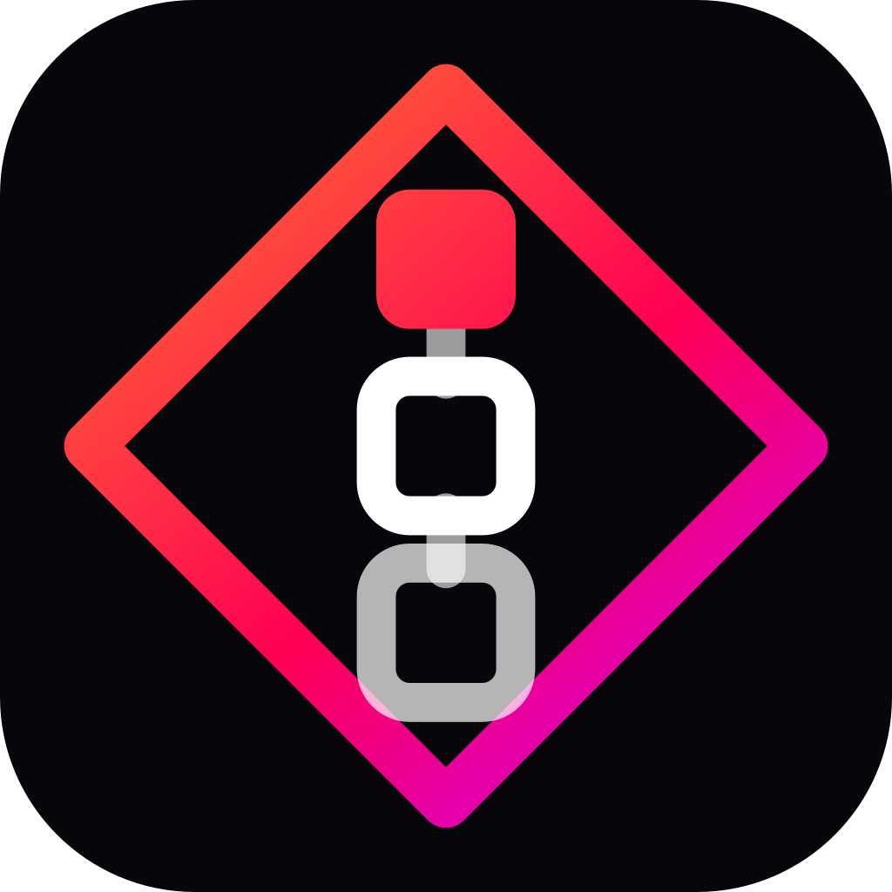

# Tracekit

Tracekit checks every tool call your coding agent makes before it runs, holds the risky ones until you say yes, and
signs each one into a record anyone can verify offline.

> **Experimental:** the plugin works and is tested, but may change and gets less hardening than the
> [stable core](https://github.com/Cygnux-Labs/Tracekit/wiki/Support). The same hooks wired by `tracekit init --dev --v2` are stable.

## Install

**Claude Code**

```bash
claude plugin marketplace add Cygnux-Labs/tracekit-plugin
claude plugin install tracekit@tracekit
```

**Codex**

```bash
codex plugin marketplace add Cygnux-Labs/tracekit-plugin
codex plugin add tracekit@tracekit
```

Codex runs a plugin's hooks only once you trust them: start `codex`, type `/hooks`, and trust Tracekit's.

**GitHub Copilot CLI**

```bash
copilot plugin marketplace add Cygnux-Labs/tracekit-plugin
copilot plugin install tracekit@tracekit
```

**Cursor**

Dashboard → Plugins & MCPs → Team Marketplaces → Add Marketplace → Import from Repo, then
`https://github.com/Cygnux-Labs/tracekit-plugin`. Without a team: copy this folder to
`~/.cursor/plugins/local/tracekit` and reload Cursor.

**Other agents:** [Devin](docs/devin.md), [Replit](docs/replit.md), and [Gemini CLI, OpenCode, Kilo Code, goose, Qwen
Code, Factory Droid, Antigravity, Crush and Cline](docs/other-agents.md).

Then tell your agent: **"Set up Tracekit."** The plugin's hooks wait until the `tracekit` package is installed, and
the setup skill installs it once you say yes. To do it yourself:

```bash
uv tool install tracekit-ai==1.7.2  # or: pipx install tracekit-ai==1.7.2 (a venv works: see When a hook can't run)
tracekit init --dev --v2            # Codex, Copilot CLI, Cursor: add --agent codex|copilot|cursor --no-hooks
                                    # (on native Windows, without --no-hooks: see Platforms)
tracekit doctor
```

## Which agent gets what

| Agent | Tracekit's hooks (every call checked and signed) | Skills |
|---|---|---|
| Claude Code | from the plugin | from the plugin, with `/tracekit-status`, `/tracekit-pending`, `/tracekit-verify` |
| Codex | from the plugin, once you trust them | from the plugin |
| Copilot CLI | from the plugin | from the plugin |
| Cursor | from the plugin | from the plugin |
| Devin | `tracekit init --agent devin` | from the plugin |
| Gemini CLI, OpenCode, Kilo Code, goose, Qwen Code, Factory Droid, Antigravity, Crush, Cline | `tracekit init --agent <name>` | `npx skills add Cygnux-Labs/tracekit-skills` |
| Replit | none: Replit Agent has no hooks | tracekit-explain, imported from GitHub |

The setup skill runs the right `tracekit init` for the agent it is in, after you say yes.

## What your agent can do for you

*Example exchanges; your numbers and ids will differ.*

**Set it up.** It looks at your past week first, read-only, and asks before it changes anything.

> **You:** Set up Tracekit.
>
> **Agent:** Before installing anything, I replayed last week's sessions through Tracekit's policy. Of 1,204 tool
> calls, it would have blocked 2 and held 9 for you. Blocked: `rm -rf ~/` (TK-D004, recursive delete of your home).
> Held: among others, 3 deletes of a remote Git branch (TK-A002). Nothing was installed or sent. Set Tracekit up for
> Claude Code?
>
> **You:** Yes.
>
> **Agent:** Done. Tracekit now checks and signs every tool call I make here; the records stay on this machine. To
> undo: `tracekit uninstall`, and turn the plugin off in `/plugin`.

**Explain what it did.** Why a call was held, what happened in a run, and the proof, from the signed record.

> **You:** Why was that held?
>
> **Agent:** I tried to upload `build/` to `s3://releases/`. Rule TK-A032 holds uploads to cloud storage, because
> files would leave this machine. To allow it once, type `! tracekit approvals approve apr-5279…`; to refuse it,
> `! tracekit approvals reject apr-5279…`. I'll wait for you.
>
> **You:** Show me the proof.
>
> **Agent:** `VERIFIED WITH GAPS`: 5 tool calls in 17 signed records, none changed after signing, and 1 signed gap
> (the transcript reader stopped). Anyone can check it offline: `tracekit verify last.tkb --trust last.trust.json`.
> In dev mode the signing key belongs to your user, so this catches mistakes, not a determined agent.

**Connect your team to Tracekit Cloud** (Tracekit 1.7.1 and later).

> **You:** Connect us to Tracekit Cloud.
>
> **Agent:** Run `tracekit connect <your team's address>` in your terminal. It prints a link and a code: sign in,
> check that the page shows the same fingerprint, and approve. From then on each finished run's signed records go to
> your team's space. Prompts, code and keys stay here.

## What stays on your machine

- The signer, its keys and the records live on your machine, under your own user (dev mode).
- Each tool call is recorded with its command, file path or URL in clear, and file contents and outputs as hashes,
  with the policy's decision. Your prompts are recorded as hashes.
- In dev mode the signer also keeps each call's redacted arguments and result, encrypted, for 7 days, so `tracekit
  view` can show them. `TRACEKIT_DEV_CONTENT=0`, set before the signer starts, keeps none.
- An exported bundle holds hashes, not content.
- The plugin sends nothing off the machine. Tracekit Cloud, if you connect it, gets signed records only, and only
  after you approve it in your browser.

Field by field: [privacy](https://github.com/Cygnux-Labs/Tracekit/wiki/Privacy).

## The one fixed rule

Your agent never approves, rejects or changes a held call, and never changes Tracekit's policy, signer, hooks or
files. When Tracekit holds a call, the agent tells you what the call was for and gives you the command to run
yourself, then waits:

```text
tracekit approvals approve <id>
```

In Claude Code you type it in the session with a leading `! `; anywhere else, in your own terminal. Tracekit enforces
the rule too: its policy blocks an agent's own approval (TK-D012) and changes to Tracekit's own files (TK-D007,
TK-D013), and holds changes to the agent's hooks and plugins, this one included, for you (TK-F009, TK-F015). The
skills never suggest a way around a hold.

## The plugin or `tracekit init`, not both

`tracekit init --dev --v2` writes the same hooks into the agent's own settings. With both, every call is decided
twice, and every call you approve is blocked anyway: one hook uses the approval and the other is refused.

- **Claude Code:** while the plugin is enabled, `tracekit init --dev --v2` installs no hooks and says so, and `tracekit
  doctor` counts the plugin's hooks (`D-HOOKS-PRESENT`) and warns when both run.
- **Codex, Copilot CLI, Cursor:** init can't see the plugin yet, so run it with `--no-hooks`: `tracekit init --dev
  --v2 --agent codex --no-hooks`. Doctor doesn't count these plugins' hooks either. On native Windows the plugin's
  hooks can't run, so there it's the other way round: init's hooks, and the plugin's turned off (Platforms, below).
- **System mode:** run init with `--no-hooks`.

## When a hook can't run

Each hook runs `scripts/tracekit-hook EVENT [AGENT]`: Tracekit's v2 hook for Claude Code
(`tracekit.integrations.claude_code`), or the one `tracekit init --agent` wires for Codex, Copilot CLI or Cursor
(`tracekit.integrations.harness_hooks`). The signer decides: deny blocks the call (`[tracekit] BLOCKED, nothing ran,
and no one can approve it`), and ask blocks it (`[tracekit] HELD, nothing ran: apr-…`) with why, what to do instead
and the commands that look at, approve or reject it. Once someone has approved it, the agent's retry of the same call
runs.

- A tool call whose hook starts but can't finish is blocked.
- Any other event (a prompt, Stop, a tool's result, a session or subagent event) is never blocked. Its error shows as a
  hook error, and the event isn't recorded. Blocking there would erase your prompt, or send the agent back to work at
  every Stop.
- **System mode** (`/etc/tracekit/client.json` exists): the hook runs only the root-owned runtime,
  `/opt/tracekit/bin/python`; `TRACEKIT_PYTHON`, `PATH` and user site-packages are ignored. If that runtime can't run
  the hook, tool calls are blocked (with `fail_mode: open` in that file they run, unrecorded, with an error shown).
  Re-run system init from a root-owned clone: `sudo /usr/bin/python3 -m tracekit init --v2 --user <agent-user>
  --no-hooks`.
- **Dev mode**: the hook runs in `TRACEKIT_PYTHON` if that has the `tracekit` package; else in the Python of a `uv
  tool` or pipx install of Tracekit (the `tracekit` command on `PATH`, or where uv or pipx put it by default), and only
  there; else in the first of `python3`, `python` and the Python beside any other `tracekit` command that has the
  package, user site-packages included (their `.pth` files don't run). A tracekit too old for the hook blocks tool
  calls and says how to upgrade. With no tracekit at all, tool calls are blocked once
  Tracekit is set up for your user: the dev signer's data directory exists (`tracekit init --dev --v2` creates it), or
  `TRACEKIT_PYTHON` or `TRACEKIT_SIGNER` is set. Before that, every event runs, unrecorded, with a notice (Copilot CLI
  and Cursor don't show it: they block a call on any notice that isn't a success).

The hooks `tracekit init --dev --v2` writes treat events the same way, but run the interpreter init ran with
(`python -I -m tracekit.integrations.claude_code <event>`; from a source checkout or a `pip install --user`, `python -I
-c` with a one-line import that puts that directory first on the path, then the directory and the event as quoted
arguments, all in plain text) instead of searching for one.

## Platforms

The hook script is POSIX shell: macOS, Linux and WSL. On native Windows:

- **Claude Code** runs it in Git Bash when Git for Windows is installed (untested). Without Git Bash it runs it in
  PowerShell, which can't, so Claude Code blocks every tool call: there, don't install the plugin, and use `tracekit
  init --dev --v2`.
- **Copilot CLI** gets the hooks as `bash` commands only, so on Windows it runs none of them: use `tracekit init --dev
  --v2 --agent copilot`.
- **Cursor** blocks every tool call when the pre-tool hook can't start (`failClosed`): don't install the plugin there,
  and use `tracekit init --dev --v2 --agent cursor`.
- **Codex** lets a call run when a hook can't start: there, use `tracekit init --dev --v2 --agent codex` (without
  `--no-hooks`), and turn the plugin's hooks off in `/hooks`.

In each case run init without `--no-hooks`, so its own hooks, which run on Windows, do the work. The setup skill does
this when it finds itself on native Windows.

## What hasn't been run yet

The Claude Code plugin is installed and tested here. For Codex, Copilot CLI and Cursor, the manifests and hook files
follow each one's documentation and source, and the hook script is tested with each one's payloads, but no one on the
team has installed the plugin in them yet. If you use one, these are the checks that matter, and a report helps
([issues](https://github.com/Cygnux-Labs/Tracekit/issues)):

- **Codex:** `codex plugin marketplace add` and `codex plugin add` work; `/hooks` lists Tracekit's five hooks from
  `hooks/codex.json`, not `hooks/claude.json`; after you trust them, a held call shows `[tracekit] HELD`.
- **Copilot CLI:** the marketplace's `"source": "./"` resolves; Copilot reads `.github/plugin/plugin.json` and runs
  only `hooks/copilot.json` (one `preToolUse` hook per call, not two); `COPILOT_PLUGIN_ROOT` is set in the hook's
  shell.
- **Cursor:** the import reads `.cursor-plugin/plugin.json`; the hooks run in Cursor's agent and CLI with
  `CURSOR_PLUGIN_ROOT` set; a held call shows Tracekit's message.

## Upgrading from the v1 plugin

Plugin versions before 1.3 ran the v1 hook against `tracekitd` (Claude Code only). This one runs the v2 hook, and
updating the plugin switches you over:

- **v1 dev mode** (`tracekit init --dev --no-hooks`): the next hook starts the v2 dev signer. Your v1 policy no longer
  applies (the v2 coding pack does), `tracekit pending` and `tracekit approve` no longer see held calls (use
  `tracekit approvals`), and once the v2 signer has recorded something, the v1 ledger can't be bridged into it.
- **v1 system mode** (`tracekit init --no-hooks` as root): every tool call is blocked until v2 system mode is set up. The
  hook's error says so.

Before the next Claude Code session after the update:

```bash
tracekit export --last -o last-v1-run.tkb                # each v1 run you need (--run ID)
tracekit uninstall                                         # stops tracekitd
tracekit signer bridge --v1-home ~/.tracekit-signer --dev  # only before the v2 signer records anything
tracekit init --dev --v2 --no-hooks
# system mode instead, in a root-owned clone of the release: sudo /usr/bin/python3 -m tracekit init --v2 --user <agent-user> --no-hooks
```

If the v2 signer has already recorded something, the bridge refuses and the two logs stay separate; both keep
verifying. Details: [migrating](https://github.com/Cygnux-Labs/Tracekit/wiki/Migration#laptop-v1--v2-signer).

System mode, for records that hold against the agent's own user, runs init from a root-owned clone of the release:
[laptop system mode](https://github.com/Cygnux-Labs/Tracekit/wiki/Deploy#laptop-system-mode). See the main
[README](https://github.com/Cygnux-Labs/Tracekit#readme) for what Tracekit proves and what it does not.
